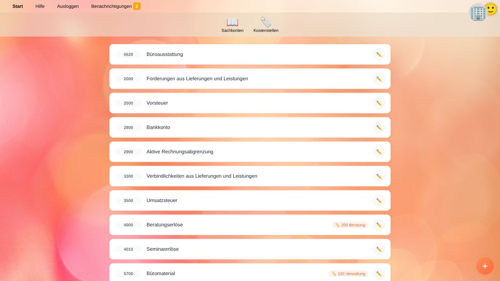
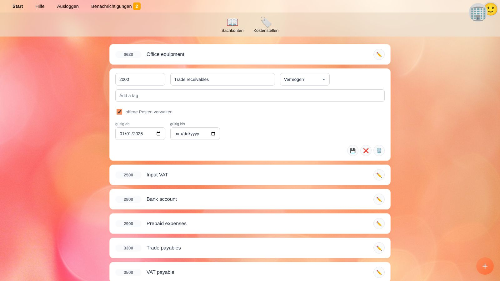
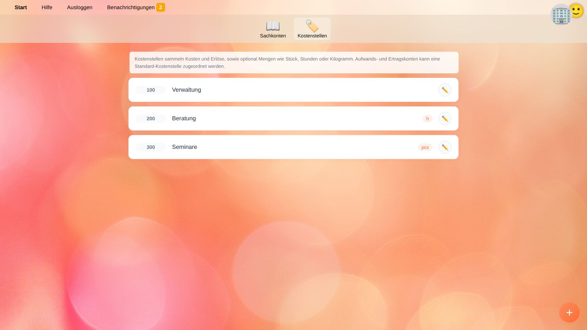

# Sachkonten und Kostenstellen

**Konten** enthält den Kontenplan und die Kostenstellen des [ausgewählten Unternehmens](getting-started.de#ein-unternehmen-auswahlen).
Mit den beiden Schaltflächen oben wechselst du zwischen **Sachkonten** und **Kostenstellen**.

## Sachkonten

Jede Buchung wird auf einem Sachkonto erfasst. Jedes Konto hat eine Nummer, eine Bezeichnung und eine Art. Die Art bestimmt, wo das Konto in den [Salden](balances.de) erscheint:

| Art | Angezeigt in | Beispiele |
| --- | --- | --- |
| **Vermögen** | Bilanz | Bankkonto, Forderungen aus Lieferungen und Leistungen, Vorsteuer, Betriebs- und Geschäftsausstattung |
| **Fremdkapital** | Bilanz | Verbindlichkeiten aus Lieferungen und Leistungen, Umsatzsteuer, Kredite |
| **Eigenkapital** | Bilanz | Stammkapital, Gewinnrücklagen |
| **Erträge** | Gewinn- und Verlustrechnung | Umsatzerlöse, Beratungserlöse |
| **Aufwendungen** | Gewinn- und Verlustrechnung | Miete, Büromaterial, Gehälter |
| **sonstiges Ergebnis (OCI)** | Bilanz (nur wenn verwendet) | Neubewertungsrücklagen nach IFRS |

Der Gewinn oder Verlust des Zeitraums (Erträge minus Aufwendungen) wird automatisch berechnet und in den Salden unter *Eigenkapital* angezeigt – dafür ist kein eigenes Konto nötig.

### Konto anlegen und bearbeiten

1. Klicke auf die runde **+**-Schaltfläche rechts unten oder auf ✏️ neben einem bestehenden Konto.
2. Fülle die unten beschriebenen Felder aus.
3. Klicke auf 💾 zum Speichern, ❌ zum Verwerfen der Änderungen oder 🗑️ zum Löschen des Kontos.

| Feld | Bedeutung |
| --- | --- |
| **Kontonummer** | Die in ganz YaBooks verwendete Nummer, z. B. in der [Schnellbuchungsfunktion](quick-recorder.de). Sie darf Buchstaben enthalten. |
| **Kontobezeichnung** | Ein sprechender Name. |
| **Art** | Siehe Tabelle oben. |
| **Tags** | Schlüsselwörter mit besonderer Bedeutung, siehe [Tags](#tags). Tag eintippen und <kbd>Enter</kbd> drücken. |
| **offene Posten verwalten** | Verfolgt, welche Buchungen dieses Kontos noch offen sind, z. B. unbezahlte Rechnungen auf Forderungs- und Verbindlichkeitenkonten. Siehe [Offene Posten](general-ledger.de#offene-posten). |
| **Standard-Kostenstelle** | Nur bei Ertrags- und Aufwandskonten: die [Kostenstelle](#kostenstellen), der Buchungen dieses Kontos zugeordnet werden, sofern im Beleg keine andere gewählt wird. |
| **gültig ab / gültig bis** | Der Zeitraum, in dem das Konto verwendet werden darf. Lass *gültig bis* bei aktiven Konten leer. |

> ⚠️ **Achtung:** Ein Konto, auf das bereits gebucht wurde, kann nicht gelöscht werden. Setze stattdessen ein *gültig bis*-Datum, damit es für neue Buchungen nicht mehr angeboten wird.

### Tags

Tags teilen YaBooks mit, wofür ein Konto verwendet wird:

| Tag | Wirkung |
| --- | --- |
| Ein **Steuercode**, z. B. `AT-V20` | Das Konto erhält die Steuerbeträge dieses Steuercodes. Die [Schnellbuchungsfunktion](quick-recorder.de#angabe-von-umsatzsteuer) bucht die Steuer auf das Konto mit dem passenden Steuercode-Tag. Tagge dein Umsatzsteuerkonto mit allen Umsatzsteuercodes und dein Vorsteuerkonto mit allen Vorsteuercodes. Siehe [Steuern](taxes.de). |
| `accruals` | Das Konto kann beim [Abgrenzen einer Buchung](general-ledger.de#abgrenzen) über mehrere Monate als Abgrenzungskonto verwendet werden, z. B. *aktive Rechnungsabgrenzung* oder *passive Rechnungsabgrenzung*. |

Apps können weitere Tags definieren.

### Bevorzugter Steuercode

Konten können einen bevorzugten Steuercode haben, z. B. `AT-V20` bei einem Erlöskonto. Die [Schnellbuchungsfunktion](quick-recorder.de#angabe-von-umsatzsteuer) wählt dann zuerst diesen Steuercode, wenn du für das Konto einen Steuersatz angibst. Der bevorzugte Steuercode wird üblicherweise von Apps gesetzt, die einen Kontenplan importieren, oder über die API.

## Kostenstellen

Kostenstellen sammeln Kosten und Erlöse unabhängig vom Hauptbuch, z. B. je Abteilung, Projekt oder Produktlinie. Sie können auch Mengen wie geleistete Stunden oder produzierte Stück erfassen.

1. Wechsle zu **Kostenstellen** und klicke auf **+**.
2. Gib **Kostenstellennummer** und **Kostenstellenbezeichnung** ein.
3. Gib optional die **Mengeneinheit** ein, z. B. `h` für Stunden, `pcs` für Stück oder `kg` für Kilogramm.
4. Klicke auf 💾.

Kostenbuchungen entstehen auf zwei Wegen:

* **Automatisch** aus Buchungen auf Ertrags- und Aufwandskonten mit Standard-Kostenstelle (die Kostenstelle kann je Buchung geändert werden).
* **Manuell** als zusätzliche Kostenbuchungen im [Reiter Kosten eines Belegs](document-editor.de#kosten), z. B. geleistete Stunden oder Budgets.

Eine Kostenstelle, die noch von einem Sachkonto oder Beleg verwendet wird, kann nicht gelöscht werden.

## Empfehlungen

* Richte den gesamten Kontenplan ein, **bevor** du die ersten Belege erfasst, siehe [Ein neues Unternehmen einrichten](workflow-setup.de).
* Aktiviere **offene Posten verwalten** für Forderungen, Verbindlichkeiten und Verrechnungskonten, damit du jederzeit siehst, welche Rechnungen unbezahlt sind.
* Verwende gut sortierbare Kontonummern, z. B. den Einheitskontenrahmen deines Landes.
* Verwende ein altes Konto nie für einen anderen Zweck; lege ein neues an und begrenze das alte mit *gültig bis*.

## Verwandte Themen

* [Steuern](taxes.de)
* [Hauptbuch](general-ledger.de)
* [Salden](balances.de)
