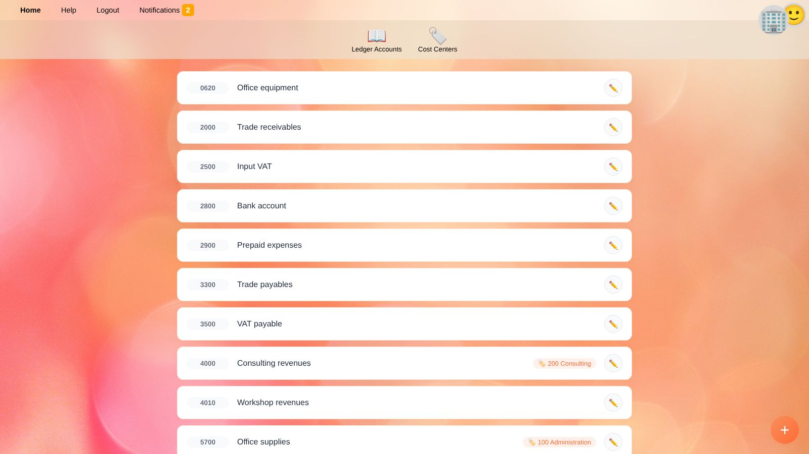
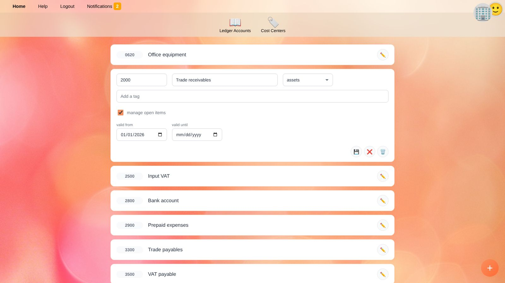
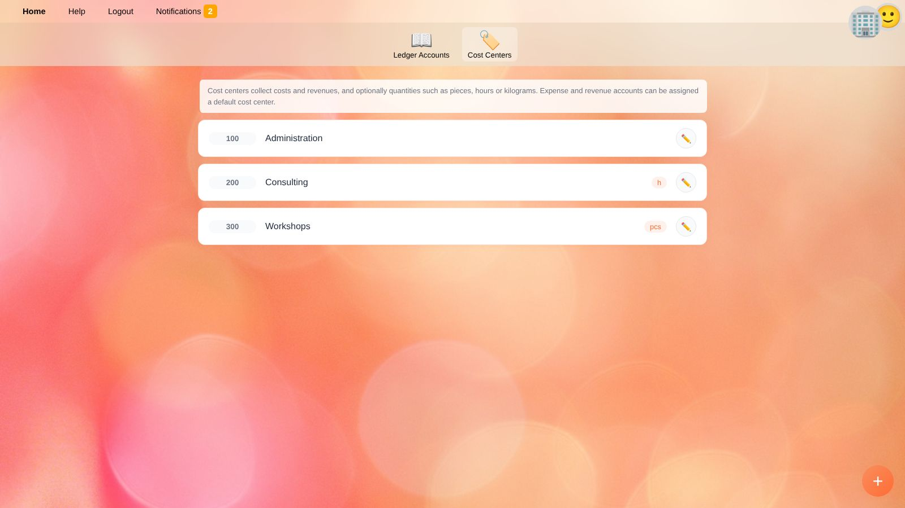

# Ledger Accounts and Cost Centers

**Accounts** holds the chart of accounts and the cost centers of the [selected business](getting-started.en#selecting-a-business).
Switch between them with the two buttons at the top: **Ledger Accounts** and **Cost Centers**.

## Ledger Accounts

Every ledger transaction is recorded on a ledger account. Each account has a number, a name and a type. The type decides where the account appears in the [balances](balances.en):

| Type | Shown in | Examples |
| --- | --- | --- |
| **assets** | Balance sheet | Bank account, trade receivables, input VAT, equipment |
| **liabilities** | Balance sheet | Trade payables, VAT payable, loans |
| **equity** | Balance sheet | Share capital, retained earnings |
| **revenues** | Income statement | Sales, consulting revenues |
| **expenses** | Income statement | Rent, office supplies, salaries |
| **other comprehensive income** | Balance sheet (only shown if used) | Revaluation reserves under IFRS |

The profit or loss of the period (revenues minus expenses) is calculated automatically and shown under *equity* in the balances – you do not need an account for it.

### Creating and Editing an Account

1. Click the round **+** button in the bottom right corner, or ✏️ next to an existing account.
2. Fill in the fields described below.
3. Click 💾 to save, ❌ to discard your changes or 🗑️ to delete the account.

| Field | Meaning |
| --- | --- |
| **Account number** | The number used everywhere in YaBooks, e.g. in the [quick recorder](quick-recorder.en). It may contain letters. |
| **Account name** | A descriptive name. |
| **Type** | See the table above. |
| **Tags** | Keywords with a special meaning, see [Tags](#tags). Type a tag and press <kbd>Enter</kbd>. |
| **manage open items** | Tracks which ledger transactions of this account are still open, e.g. unpaid invoices on receivables and payables. See [Open items](general-ledger.en#open-items). |
| **default cost center** | Only for revenue and expense accounts: the [cost center](#cost-centers) that ledger transactions of this account are assigned to, unless a different one is chosen in the document. |
| **valid from / valid until** | The period the account may be used in. Leave *valid until* empty for accounts that are still in use. |

> ⚠️ **Warning:** An account that has already been booked on cannot be deleted. Set a *valid until* date instead, so it is no longer offered for new transactions.

### Tags

Tags tell YaBooks what an account is used for:

| Tag | Effect |
| --- | --- |
| A **tax code**, e.g. `at.vat.output` | The account receives the tax amounts of this tax code. The [quick recorder](quick-recorder.en#specification-of-vat) posts tax to the account tagged with the matching tax code. Tag your VAT payable account with all output tax codes and your input VAT account with all input tax codes. See [Taxes](taxes.en). |
| `accruals` | The account can be used as an accrual account when [accruing a ledger transaction](general-ledger.en#accruing) over several months, e.g. *prepaid expenses* or *deferred income*. |

Apps may define further tags.

### Preferred Tax Code

Accounts can have a preferred tax code, e.g. `at.vat.output` for a revenue account. The [quick recorder](quick-recorder.en#specification-of-vat) then picks this tax code first when you enter a tax percentage for the account. The preferred tax code is usually set by apps that import a chart of accounts, or through the API.

## Cost Centers

Cost centers collect costs and revenues independently of the general ledger, e.g. per department, project or product line. They can also collect quantities such as hours worked or pieces produced.

1. Switch to **Cost Centers** and click **+**.
2. Enter a **cost center number** and a **cost center name**.
3. Optionally enter the **unit of quantities**, e.g. `h` for hours, `pcs` for pieces or `kg` for kilograms.
4. Click 💾.

Cost transactions are recorded in two ways:

* **Automatically** from ledger transactions on revenue and expense accounts with a default cost center (the cost center can be changed per transaction).
* **Manually** as additional cost transactions in the [Costs tab of a document](document-editor.en#costs), e.g. hours worked or budgets.

A cost center that is still used by a ledger account or a document cannot be deleted.

## Recommended Practice

* Set up the whole chart of accounts **before** recording the first documents, see [Setting up a new business](workflow-setup.en).
* Enable **manage open items** for receivables, payables and clearing accounts, so you always see which invoices are unpaid.
* Use account numbers that sort well, e.g. the standard chart of accounts of your country.
* Never reuse an old account for a different purpose; create a new one and limit the old one with *valid until*.

## Related Topics

* [Taxes](taxes.en)
* [General ledger](general-ledger.en)
* [Balances](balances.en)
