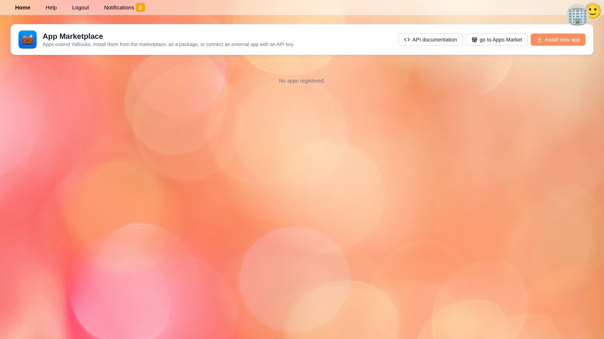

# Apps

Apps extend YaBooks with new features, e.g. banking connections, invoicing, payroll, OCR, tax returns or a chart of accounts for your country.
Installed apps appear as tiles on the [home screen](getting-started.en#the-home-screen) and work with the same data as YaBooks itself.

Open **Apps Market** from the home screen to see and manage all registered apps.

## Registered Apps

Each registered app shows its name, whether it is **installed** (runs on this server) or **external** (runs elsewhere and connects through the API), and when it was registered.

* **permissions** opens the [access settings](settings.en#app-access) of the app.
* **remove** shuts down and unregisters the app.

> ⚠️ **Warning:** When an app is removed, its configuration may be lost: its documents that are not assigned to a business are deleted.

The buttons at the top:

* **API documentation** – the interactive documentation of the YaBooks API, for developers and for connecting external apps.
* **go to Apps Market** – the marketplace where apps can be purchased.
* **install new app** – see below. Only shown to users who may install apps.

## Installing an App

Click **install new app** and choose a method:

| Method | When to use it |
| --- | --- |
| **Subscription code** | You purchased an app in the marketplace and received a code. Enter the code. |
| **ZIP archive** | You received an app package (a ZIP file containing a `package.json`). Drop it onto the field or click to choose it. The app runs on this server. |
| **API key** | The app runs elsewhere (e.g. a cloud service or your own script). Enter a name; YaBooks generates an API key the app uses to connect. |

Then choose the **role** the app acts with and its **scope** – a single business, *all businesses* or *everything* – and click **Install**.
The role decides what the app may do; you can fine-tune it later in [Settings → App access](settings.en#app-access).

> 💡 **Tip:** Give apps only the permissions they need. A banking app, for example, needs to read and write documents and record ledger transactions for the businesses it serves, but not to manage users.

### API Keys

When you connect an external app with an API key, the key is shown **only once**. Click **Copy**, store it in the configuration of the external app and click **Done**. If the key gets lost, remove the app and register it again.

## Apps and Your Data

* Apps can create documents, ledger transactions, notifications and tasks. Changes made by apps are recorded in the [audit log](settings.en#logs) with the app's name.
* Apps can hand over work to each other through [jobs](settings.en#jobs).
* Tax codes provided by an app are marked in [Settings → Tax codes](taxes.en#tax-codes).

## Related Topics

* [Settings → App access](settings.en#app-access)
* [YaCob AI](yacob.en)
