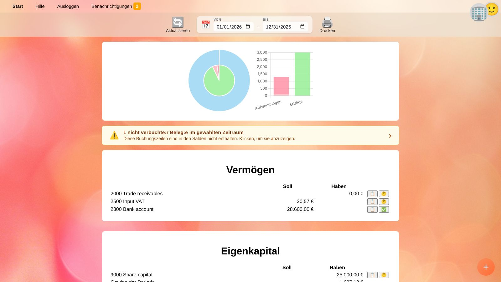
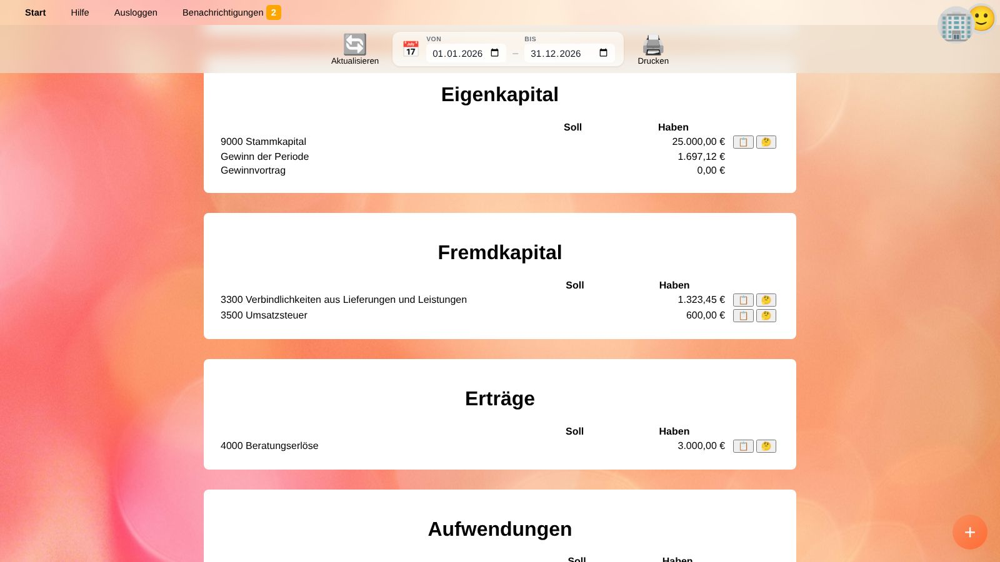
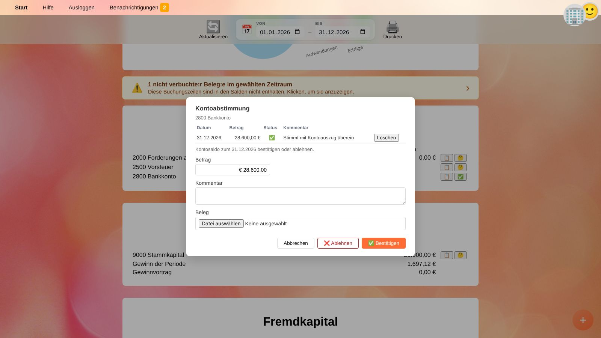

# Salden

**Salden** zeigt Bilanz sowie Gewinn- und Verlustrechnung des [ausgewählten Unternehmens](getting-started.de#ein-unternehmen-auswahlen) für einen frei wählbaren Zeitraum.

## Zeitraum wählen

* **Von** / **Bis** legen den Zeitraum fest. Beim Öffnen wird das laufende Wirtschaftsjahr angezeigt (anhand von Abschlussmonat und -tag in den [Unternehmenseinstellungen](people.de#unternehmen)).
* 🔄 **Aktualisieren** lädt die Zahlen neu, z. B. nachdem du in einem anderen Fenster gebucht hast.
* 🖨️ **Drucken** druckt die Salden mit Unternehmensname und Zeitraum als Kopfzeile; mit *Als PDF speichern* im Druckdialog erstellst du ein PDF.

Der Zeitraum ist Teil der Seitenadresse; mit der Zurück-Schaltfläche des Browsers gelangst du zum zuvor angezeigten Zeitraum.

**Bilanzkonten** (Vermögen, Fremdkapital, Eigenkapital) zeigen ihren Saldo zum *Bis*-Datum, einschließlich aller Buchungen vor dem Zeitraum.
**Erfolgskonten** (Erträge, Aufwendungen) zeigen nur die Bewegungen innerhalb des Zeitraums.

## Diagramme

* Das **Ringdiagramm** links zeigt die Struktur der Bilanz: Ein Ring zeigt das Vermögen, der andere Eigen- und Fremdkapital. Fahre mit der Maus über ein Segment, um Konto und Betrag zu sehen.
* Das **Balkendiagramm** rechts vergleicht Aufwendungen und Erträge je Konto.

## Ungebuchte Belege

Enthalten Entwürfe (ungebuchte Belege) Buchungen im Zeitraum, zeigt ein gelber Balken, wie viele es sind.
Diese Buchungen sind in den Salden **nicht** enthalten. Ein Klick auf den Balken listet die Belege auf; buche oder lösche diese.

## Kontensalden

Die Konten sind nach Art gruppiert: *Vermögen*, *Eigenkapital*, *Fremdkapital*, *Erträge*, *Aufwendungen* (und *sonstiges Ergebnis*, falls verwendet). Jedes Konto zeigt seinen Saldo in der Spalte **Soll** oder **Haben**.

Der Abschnitt *Eigenkapital* zeigt außerdem

* **Gewinn / Verlust der Periode** – Erträge minus Aufwendungen des Zeitraums, und
* **Gewinn- / Verlustvortrag** – den Saldo der Erfolgskonten vor dem Zeitraum, also Ergebnisse früherer Zeiträume, die noch auf diesen Konten stehen.

Neben jedem Konto:

| Schaltfläche | Aktion |
| --- | --- |
| 📋 | Zeigt die Buchungen des Kontos im Zeitraum im [Hauptbuch](general-ledger.de). |
| 🤔 ✅ ❌ ⁉️ | Öffnet die [Kontoabstimmung](#kontoabstimmung). Das Symbol zeigt ihren Status. |

## Kontoabstimmung

Eine Kontoabstimmung dokumentiert, dass du den Saldo eines Kontos zum *Bis*-Datum mit einem externen Nachweis abgeglichen hast, z. B. Kontoauszug, Saldenbestätigung eines Lieferanten oder Inventurliste.

1. Setze **Bis** auf das zu bestätigende Datum, z. B. den Bilanzstichtag.
2. Klicke auf das Statussymbol neben dem Konto.
3. Gib den **Betrag** laut Nachweis, optional einen **Kommentar** ein und hänge den Nachweis als **Beleg** an (z. B. das PDF des Kontoauszugs).
4. Klicke auf ✅ **Bestätigen**, wenn der Saldo stimmt, oder auf ❌ **Ablehnen**, wenn nicht.

Das Symbol neben dem Konto zeigt dann:

| Symbol | Status |
| --- | --- |
| 🤔 | Noch unbekannt – für das *Bis*-Datum gibt es keine Abstimmung. |
| ✅ | Bestätigt – bestätigt, und der bestätigte Betrag entspricht dem aktuellen Saldo. |
| ❌ | Abgelehnt – der Saldo ist falsch und muss korrigiert werden. |
| ⁉️ | Fraglich – der Saldo wurde bestätigt, hat sich seither aber geändert (oder die Beträge stimmen nicht überein). Prüfe, was danach gebucht wurde. |

Der Dialog listet frühere Abstimmungseinträge des Zeitraums mit einem Link zum Nachweis. Mit **Löschen** entfernst du einen Eintrag.

> 💡 **Tipp:** Stimme vor dem Sperren eines Zeitraums zumindest Bank, Kassa, Forderungen, Verbindlichkeiten und Steuerkonten ab. Siehe [Jahresabschluss vor der Veröffentlichung prüfen](workflow-financial-statements.de).

## Schnellbuchungsfunktion

Die runde **+**-Schaltfläche rechts unten öffnet die [Schnellbuchungsfunktion](quick-recorder.de), z. B. um eine beim Prüfen gefundene Korrektur zu buchen. Klicke danach auf 🔄 **Aktualisieren**.

## Verwandte Themen

* [Hauptbuch](general-ledger.de)
* [Jahresabschluss vor der Veröffentlichung prüfen](workflow-financial-statements.de)
* [Sachkonten](accounts.de)
