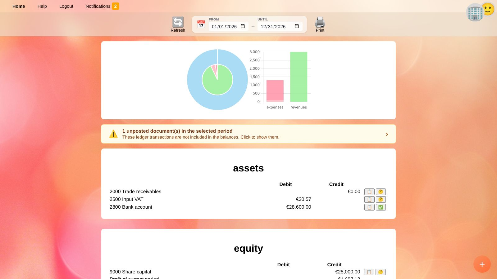
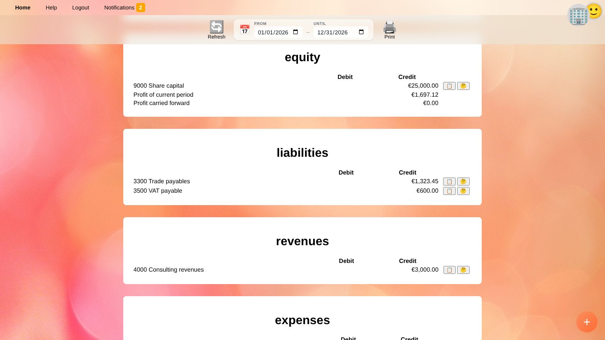
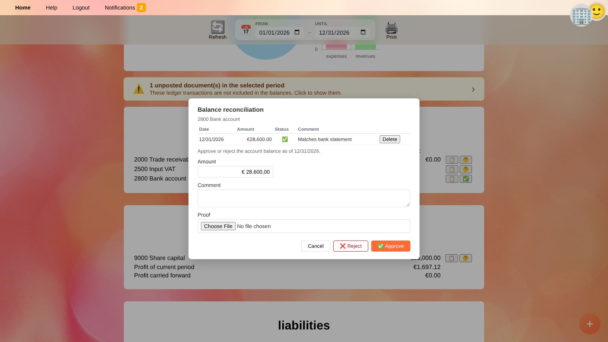

# Balances

**Balances** shows the balance sheet and the income statement of the [selected business](getting-started.en#selecting-a-business) for a period of your choice.

## Choosing the Period

* **From** / **Until** set the period. When you open the balances, the current fiscal year is shown (based on the closing month and day in the [business settings](people.en#businesses)).
* 🔄 **Refresh** reloads the numbers, e.g. after you posted a document in another window.
* 🖨️ **Print** prints the balances with the business name and the period as header; use *Save as PDF* in the print dialog to create a PDF.

The period is part of the page address, so your browser's back button returns to the previously shown period.

**Balance sheet accounts** (assets, liabilities, equity) show their balance as of the *Until* date, including everything posted before the period.
**Income statement accounts** (revenues, expenses) show only the movements within the period.

## Charts

* The **ring chart** on the left shows the structure of the balance sheet: one ring shows the assets, the other one equity and liabilities. Hover over a segment to see the account and amount.
* The **bar chart** on the right compares expenses and revenues per account.

## Unposted Documents

If drafts (unposted documents) contain ledger transactions within the period, a yellow bar shows how many there are.
These transactions are **not** included in the balances. Click the bar to list the documents, then post or delete them.

## Account Balances

The accounts are grouped by type: *assets*, *equity*, *liabilities*, *revenues*, *expenses* (and *other comprehensive income*, if used). Each account shows its balance in the **Debit** or **Credit** column.

The *equity* section also shows

* **Profit / loss of current period** – revenues minus expenses of the period, and
* **Profit / loss carried forward** – the balance of the revenue and expense accounts before the period, i.e. results of earlier periods that are still on these accounts.

Next to each account:

| Button | Action |
| --- | --- |
| 📋 | Shows the account's ledger transactions of the period in the [general ledger](general-ledger.en). |
| 🤔 ✅ ❌ ⁉️ | Opens the [balance reconciliation](#balance-reconciliation). The icon shows its status. |

## Balance Reconciliation

A balance reconciliation documents that you checked the balance of an account as of the *Until* date against external evidence, e.g. a bank statement, a confirmation of balance from a supplier or an inventory list.

1. Set **Until** to the date you want to confirm, e.g. the balance sheet date.
2. Click the status icon next to the account.
3. Enter the **Amount** according to the evidence, an optional **Comment** and attach the evidence as **Proof** (e.g. the PDF of the bank statement).
4. Click ✅ **Approve** if the balance is correct, or ❌ **Reject** if it is not.

The icon next to the account then shows:

| Icon | Status |
| --- | --- |
| 🤔 | Not yet known – no reconciliation exists for the *Until* date. |
| ✅ | Confirmed – approved, and the approved amount matches the current balance. |
| ❌ | Rejected – the balance is wrong and has to be corrected. |
| ⁉️ | Questionable – the balance was approved, but it has changed since (or the amounts do not match). Check what was posted afterwards. |

The dialog lists earlier reconciliation entries of the period, with a link to their proof. Entries can be deleted with **Delete**.

> 💡 **Tip:** Reconcile at least the bank, cash, receivables, payables and tax accounts before you lock a period. See [Checking the financial statements before publishing](workflow-financial-statements.en).

## Quick Recorder

The round **+** button in the bottom right corner opens the [quick recorder](quick-recorder.en), e.g. to book a correction you found while checking the balances. Click 🔄 **Refresh** afterwards.

## Related Topics

* [General ledger](general-ledger.en)
* [Checking the financial statements before publishing](workflow-financial-statements.en)
* [Ledger accounts](accounts.en)
