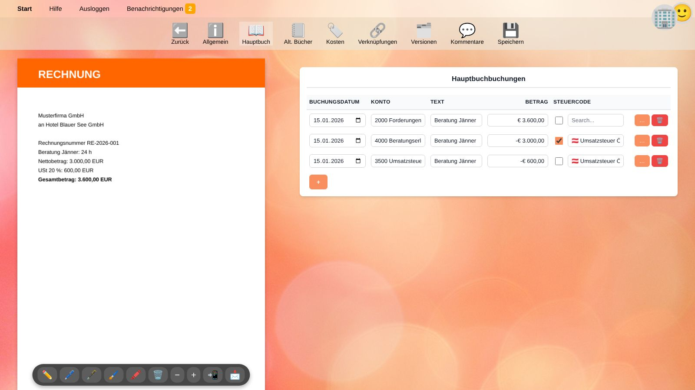
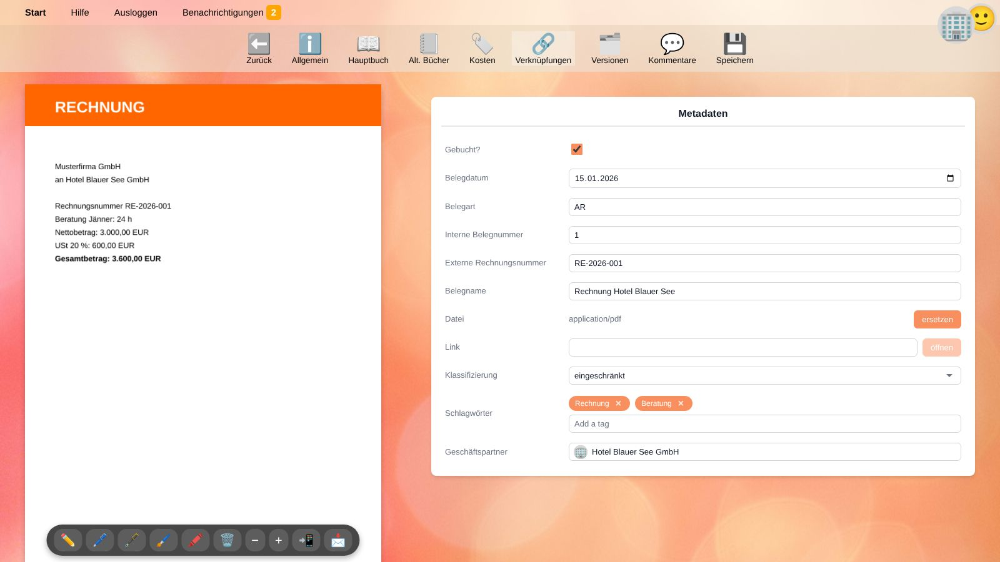
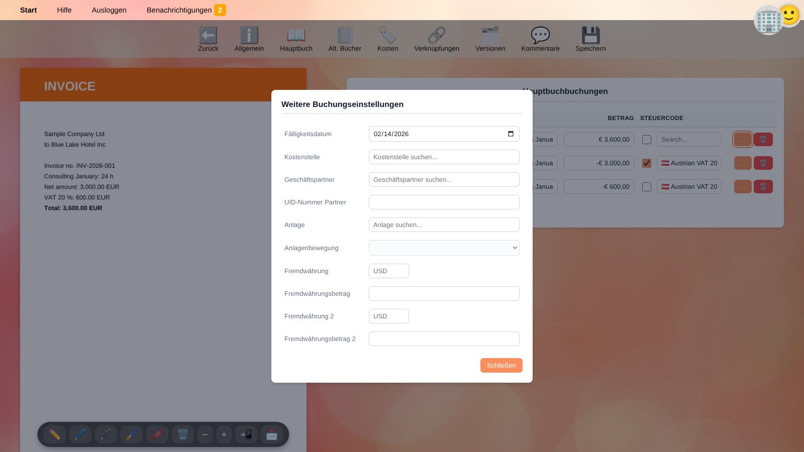
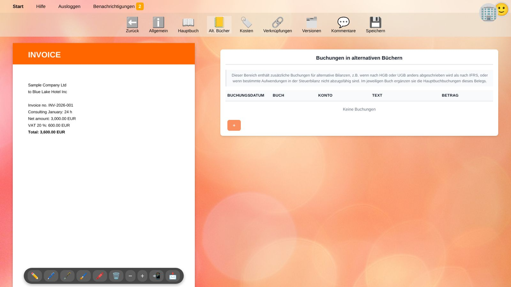
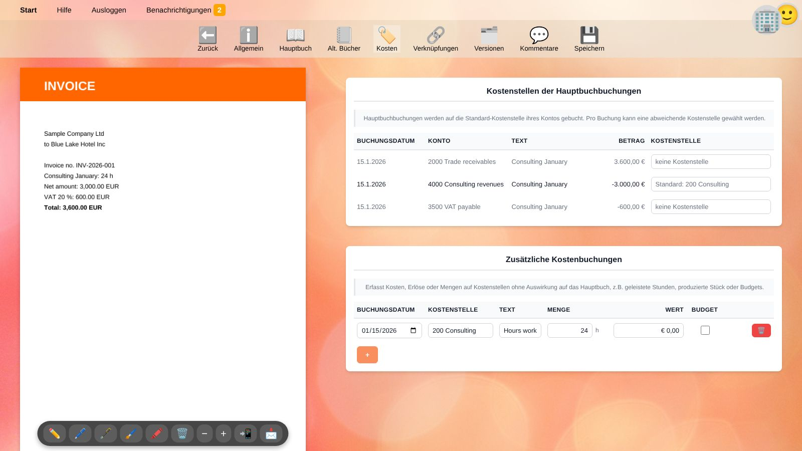
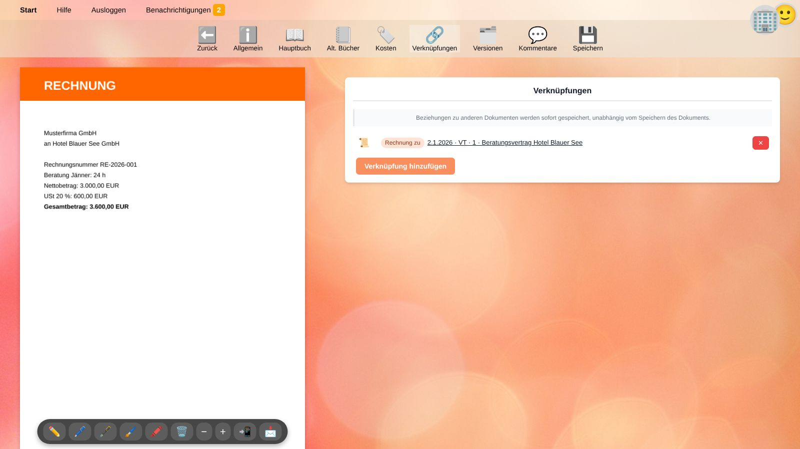
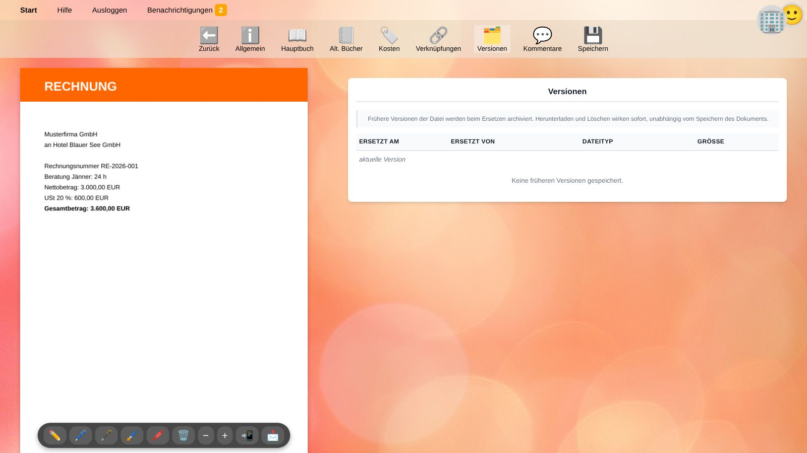
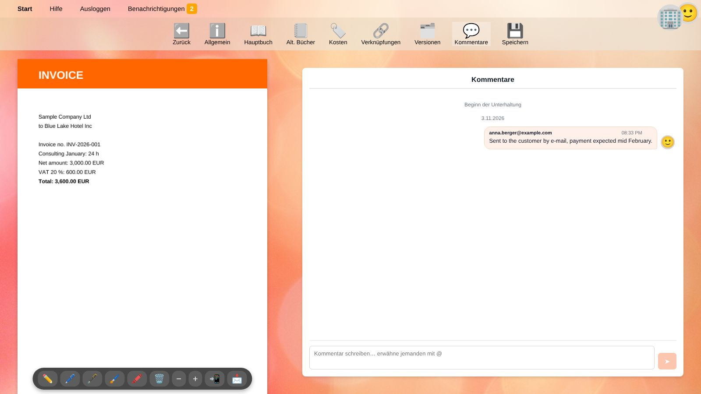

# Beleg-Editor

Der Beleg-Editor zeigt einen Beleg neben all seinen Daten. Du öffnest ihn mit ✏️ in der [Belegliste](documents.de), aus dem [Hauptbuch](general-ledger.de) oder aus der [Schnellbuchungsfunktion](quick-recorder.de).

Die Datei wird links angezeigt (auf schmalen Bildschirmen oberhalb der Daten), der gewählte Reiter rechts. Die Leiste oben enthält die Reiter:

| Schaltfläche | Inhalt |
| --- | --- |
| ⬅️ **Zurück** | Zurück zur vorherigen Seite. |
| ℹ️ **Allgemein** | [Metadaten](#allgemein) des Belegs. |
| 📖 **Hauptbuch** | [Hauptbuchbuchungen](#hauptbuch). |
| 📒 **Alt. Bücher** | [Buchungen in alternativen Büchern](#alternative-bucher). |
| 🏷️ **Kosten** | [Kostenstellen und Kostenbuchungen](#kosten). |
| 🔗 **Verknüpfungen** | [Beziehungen zu anderen Belegen](#verknupfungen). |
| 🗂️ **Versionen** | [Frühere Versionen der Datei](#versionen). |
| 💬 **Kommentare** | [Unterhaltung über den Beleg](#kommentare). |
| 💾 **Speichern** | Speichert die Änderungen der Reiter *Allgemein*, *Hauptbuch*, *Alt. Bücher* und *Kosten*. |

> ⚠️ **Achtung:** Änderungen der ersten vier Reiter werden erst mit **💾 Speichern** übernommen. Eine Meldung oben zeigt, ob das Speichern geklappt hat. Verknüpfungen, Versionen und Kommentare werden dagegen sofort gespeichert.

## Die Dateivorschau

Die Werkzeugleiste unter der Vorschau bietet:

* ✏️ 🖊️ 🖋️ 🖌️ 🖍️ **Zeichnen** und den **Radierer** 🗑️, um den Beleg zu kommentieren oder zu unterschreiben (bei unterstützten Dateitypen).
* **−** / **+** zum Verkleinern und Vergrößern.
* 📲 **Auf Tablet öffnen** zeigt den Beleg auf einem zweiten Bildschirm, z. B. einem Tablet zum Unterschreiben. Ein bereits als zweiter Bildschirm geöffnetes Tablet öffnet ihn sofort; andernfalls wird ein Code angezeigt, den du mit dem Tablet scannst – es wird ohne Passworteingabe angemeldet.
* 📩 **Datei herunterladen**.

## Allgemein

| Feld | Bedeutung |
| --- | --- |
| **Gebucht?** | Angehakt: Die Buchungen zählen in den [Salden](balances.de). Nicht angehakt: Der Beleg ist ein Entwurf. Ein gebuchter Beleg muss ausgeglichen sein, siehe [Hauptbuch](#hauptbuch). |
| **Belegdatum** | Datum des Belegs, z. B. das Rechnungsdatum. |
| **Belegart** | Kürzel wie `AR` oder `ER`, siehe [Belegarten](documents.de#belegarten). |
| **Interne Belegnummer** | Deine fortlaufende Nummer innerhalb der Belegart. |
| **Externe Rechnungsnummer** | Die Nummer auf dem Beleg, z. B. die Rechnungsnummer des Lieferanten. |
| **Belegname** | Ein sprechender Name. |
| **Datei** | Der Dateityp der angehängten Datei. **hochladen** fügt eine Datei hinzu, **ersetzen** ersetzt sie – die bisherige Datei bleibt als [Version](#versionen) erhalten. |
| **Link** | Eine optionale Webadresse zum Beleg, z. B. in einem Webshop. **öffnen** öffnet sie. |
| **Klassifizierung** | Vertraulichkeit: *offiziell*, *eingeschränkt* (Standard), *vertraulich*, *geheim* oder *streng geheim*. |
| **Schlagwörter** | Freie Stichwörter zum Suchen und Filtern. |
| **Geschäftspartner** | Kunde, Lieferant oder andere Person bzw. Organisation, zu der der Beleg gehört. Tippe einen Namen, um zu suchen. |

## Hauptbuch

Der Reiter Hauptbuch enthält die Hauptbuchbuchungen des Belegs. Jede Zeile ist eine Buchung:

| Spalte | Bedeutung |
| --- | --- |
| **Buchungsdatum** | Bestimmt, in welchem Zeitraum die Buchung zählt. |
| **Konto** | Das [Sachkonto](accounts.de). Nummer oder Bezeichnung eintippen, um zu suchen. |
| **Text** | Buchungstext, z. B. *Einkauf Büromaterial*. |
| **Betrag** | **Positive Beträge stehen im Soll, negative im Haben.** |
| **Steuercode** | [Steuercode](taxes.de) und Steuersatz. Hake das Kästchen an, wenn diese Zeile die **Bemessungsgrundlage** ist (der Nettobetrag, von dem die Steuer berechnet wird); lass es bei der Zeile mit dem **Steuerbetrag** selbst leer. |
| … | [Weitere Buchungseinstellungen](#weitere-buchungseinstellungen) der Zeile. |
| 🗑️ | Entfernt die Zeile. |

Mit **+** fügst du eine Zeile hinzu. Die neue Zeile übernimmt Datum und Text der vorherigen und schlägt den Betrag vor, der zum Ausgleich noch fehlt.

### Ausgleich von Soll und Haben

Je Buchungsdatum müssen Soll und Haben gleich sein, d. h. die Beträge eines Datums müssen in Summe null ergeben.
Andernfalls zeigt die Warnung ⚠️ **Differenz:** den Unterschied und das Datum. Ein Beleg mit Differenz kann als Entwurf gespeichert, aber nicht gebucht werden.

Beispiel einer Ausgangsrechnung über 3.000,00 zuzüglich 20 % USt:

| Konto | Betrag | Steuercode | Bemessungsgrundlage |
| --- | ---: | --- | --- |
| 2000 Forderungen | 3.600,00 | | |
| 4000 Beratungserlöse | −3.000,00 | AT-V20 20 % | ☑ |
| 3500 Umsatzsteuer | −600,00 | AT-V20 20 % | ☐ |

> 💡 **Tipp:** Einfache Buchungen erfasst die [Schnellbuchungsfunktion](quick-recorder.de) samt Steuerzeile aus einer einzigen Textzeile.

### Weitere Buchungseinstellungen

Ein Klick auf … am Zeilenende öffnet weitere Einstellungen:

| Einstellung | Bedeutung |
| --- | --- |
| **Verweise** (oben) | Zeigt, ob die Zeile *Zahlung*, *Skonto*, *Umbuchung*, *Storno* oder *Abgrenzung* einer anderen Buchung ist. Mit ✕ entfernst du einen solchen Verweis. Siehe [Offene Posten](general-ledger.de#offene-posten). |
| **Fälligkeitsdatum** | Wann ein offener Posten fällig ist, z. B. das Zahlungsziel einer Rechnung. |
| **Kostenstelle** | Eine von der Standard-Kostenstelle des Kontos abweichende Kostenstelle. |
| **Geschäftspartner** | Ein abweichender Geschäftspartner dieser Zeile, z. B. auf einem Kontoauszug mit Zahlungen mehrerer Kunden. |
| **UID-Nummer Partner** | Die Umsatzsteuer-Identifikationsnummer des Geschäftspartners, z. B. für die Zusammenfassende Meldung. |
| **Anlage** und **Anlagenbewegung** | Verknüpft die Zeile mit einem Anlagegut und gibt an, ob es sich um *Zugang*, *Abschreibung* oder *Abgang* handelt. Beides muss ausgefüllt oder beides leer sein. |
| **Fremdwährung / Fremdwährungsbetrag** (und **2**) | Der Betrag in Fremdwährung, z. B. der USD-Betrag einer in EUR gebuchten Rechnung. |

## Alternative Bücher

Alternative Bücher enthalten **zusätzliche** Buchungen für andere Bilanzen, z. B. wenn die Steuerbilanz eine andere Abschreibung als die Unternehmensbilanz verwendet oder ein Aufwand steuerlich nicht abzugsfähig ist.
Im jeweiligen Buch werden diese Buchungen zu den Hauptbuchbuchungen des Belegs addiert.

* Registriere zuerst die Namen der Bücher (z. B. `Steuer`) in den [Einstellungen des Unternehmens](people.de#unternehmen). Sonst können keine Zeilen hinzugefügt werden.
* Wähle für jede Zeile das **Buch**. Jedes Buch muss je Buchungsdatum für sich ausgeglichen sein.
* In alternativen Büchern können keine Steuercodes verwendet werden.

## Kosten

**Kostenstellen der Hauptbuchbuchungen:** Buchungen auf Ertrags- und Aufwandskonten werden auf die Standard-Kostenstelle ihres Kontos gebucht. Hier wählst du für einzelne Zeilen eine andere Kostenstelle.

**Zusätzliche Kostenbuchungen** erfassen Kosten, Erlöse oder Mengen auf Kostenstellen ohne Auswirkung auf das Hauptbuch, z. B. 24 für einen Kunden geleistete Stunden, produzierte Stück oder Budgetwerte:

| Spalte | Bedeutung |
| --- | --- |
| **Buchungsdatum** | Datum der Kostenbuchung. |
| **Kostenstelle** | Pflichtfeld. |
| **Text** | Beschreibung. |
| **Menge** | Menge in der Einheit der Kostenstelle, z. B. Stunden. |
| **Wert** | Geldbetrag. |
| **Budget** | Angehakt: Die Zeile ist ein Planwert (Budget) statt eines Istwerts. |

## Verknüpfungen

Verknüpfungen verbinden Belege miteinander, z. B. eine Gutschrift mit der korrigierten Rechnung oder einen Lieferschein mit der Bestellung.

1. Klicke auf **Verknüpfung hinzufügen**.
2. Suche den anderen Beleg nach Name, Art oder Referenz.
3. Gib die **Beziehung** ein, z. B. `Gutschrift zu`. Bereits verwendete Beziehungen werden vorgeschlagen.
4. Wähle optional ein **Symbol**, kehre mit **Richtung umkehren** bei Bedarf die Richtung um und klicke auf **verknüpfen**.

Verknüpfungen werden sofort gespeichert. Mit ✕ entfernst du eine Verknüpfung.

## Versionen

Wird die Datei eines Belegs ersetzt, wird die bisherige Datei als Version archiviert. Die Liste zeigt, wann und von wem (Benutzer oder App) jede Version ersetzt wurde, ihren Dateityp und ihre Größe.
Versionen können heruntergeladen oder gelöscht werden; dies wirkt sofort.

## Kommentare

Besprich einen Beleg direkt dort, wo er gespeichert ist, z. B. um eine Kollegin um die Freigabe einer Rechnung zu bitten.

* Schreibe einen Kommentar und klicke auf **Senden**.
* Tippe `@`, um jemanden zu erwähnen. Erwähnte Benutzer erhalten eine [Benachrichtigung](getting-started.de#benachrichtigungen) mit einem Link zum Beleg.
* Mit ✕ löschst du einen deiner eigenen Kommentare.

## Einen Beleg buchen

1. Prüfe, dass alle Zeilen ein Buchungsdatum und ein Konto haben und keine Warnung ⚠️ **Differenz** angezeigt wird.
2. Hake im Reiter **Allgemein** das Feld **Gebucht?** an.
3. Klicke auf **💾 Speichern**.

Gebuchte Belege können weiterhin geändert werden, solange ihre Buchungsdaten nicht in einem [gesperrten Zeitraum](people.de#unternehmen) liegen. Um einen gebuchten Beleg in einem gesperrten Zeitraum zu korrigieren, [storniere](general-ledger.de#stornieren) die Buchung stattdessen in einem offenen Zeitraum.

## Verwandte Themen

* [Belege](documents.de)
* [Hauptbuch](general-ledger.de)
* [Steuern](taxes.de)
