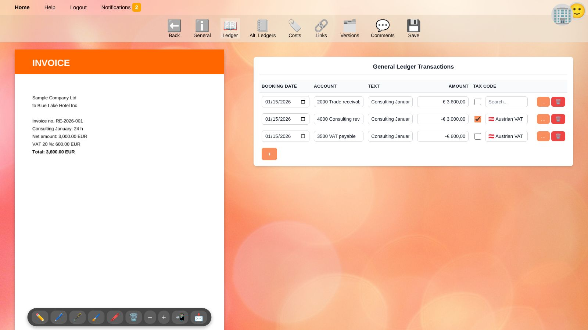
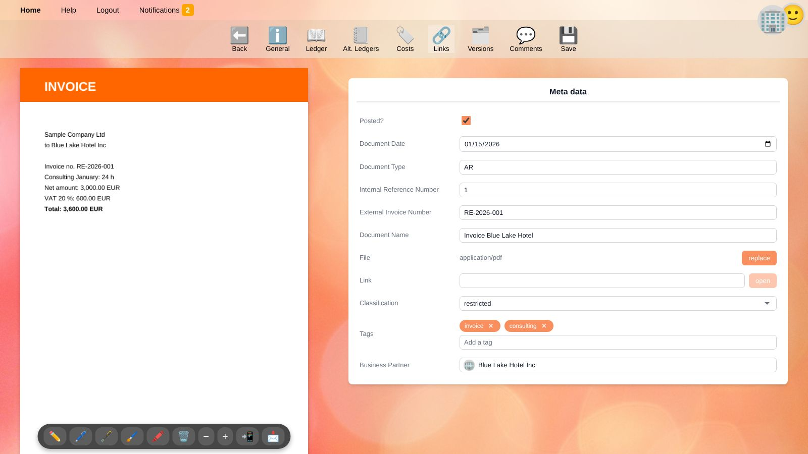
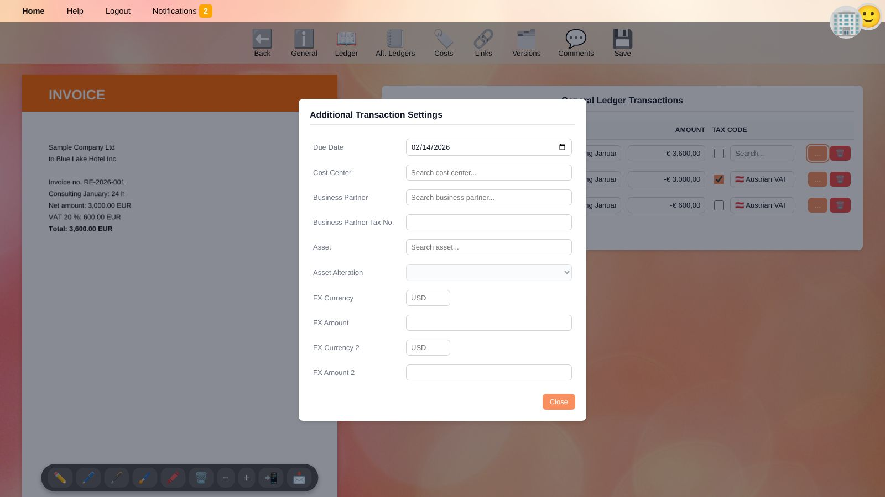
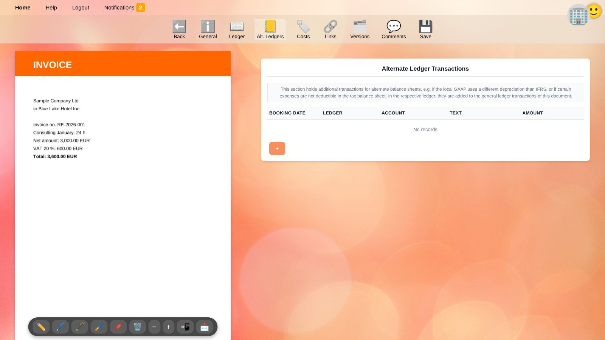
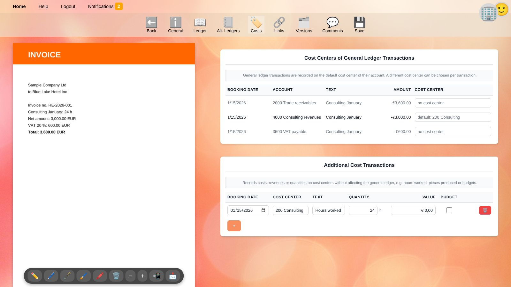
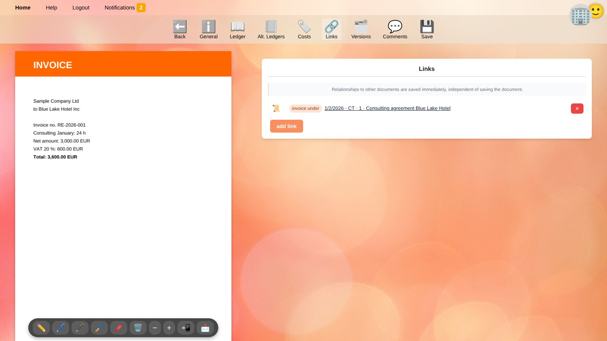
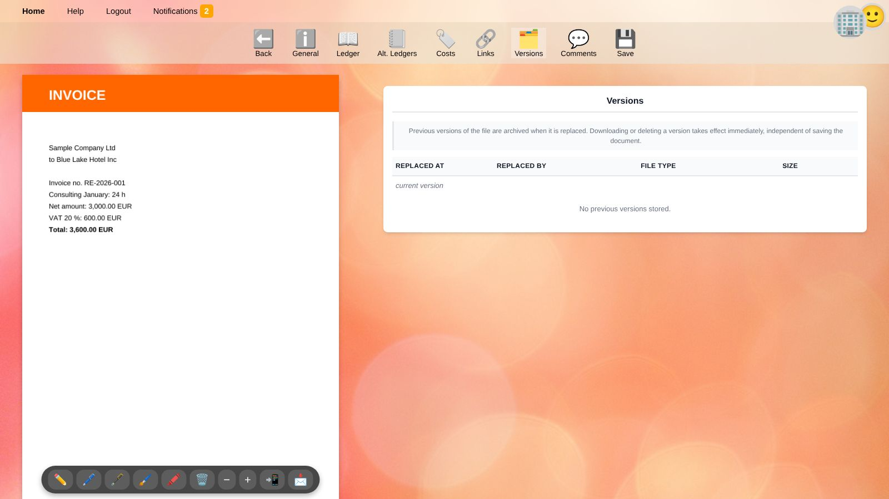
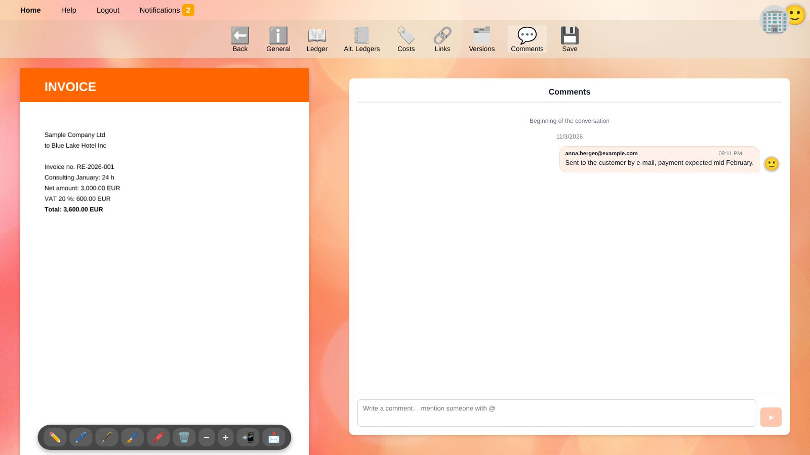

# Document Editor

The document editor shows a document next to all of its data. Open it with ✏️ in the [document list](documents.en), from the [general ledger](general-ledger.en) or from the [quick recorder](quick-recorder.en).

The file is shown on the left (on narrow screens above the data), the selected tab on the right. The bar at the top holds the tabs:

| Button | Content |
| --- | --- |
| ⬅️ **Back** | Returns to the previous page. |
| ℹ️ **General** | [Metadata](#general) of the document. |
| 📖 **Ledger** | [General ledger transactions](#ledger). |
| 📒 **Alt. Ledgers** | [Transactions of alternate ledgers](#alternate-ledgers). |
| 🏷️ **Costs** | [Cost centers and cost transactions](#costs). |
| 🔗 **Links** | [Relationships to other documents](#links). |
| 🗂️ **Versions** | [Previous versions of the file](#versions). |
| 💬 **Comments** | [Conversation about the document](#comments). |
| 💾 **Save** | Saves the changes of the *General*, *Ledger*, *Alt. Ledgers* and *Costs* tabs. |

> ⚠️ **Warning:** Changes of the first four tabs are only stored when you click **💾 Save**. A message at the top tells you whether saving succeeded. Links, versions and comments, on the other hand, are saved immediately.

## The File Preview

The toolbar below the preview offers:

* ✏️ 🖊️ 🖋️ 🖌️ 🖍️ **Draw** tools and the **eraser** 🗑️ to annotate or sign the document (for supported file types).
* **−** / **+** to zoom.
* 📲 **Open on tablet** shows the document on a second screen, e.g. a tablet for signing. A tablet that is already open as a second screen opens it immediately; otherwise a code is shown that you scan with the tablet – it is signed in without entering a password.
* 📩 **Download file**.

## General

| Field | Meaning |
| --- | --- |
| **Posted?** | Checked: the ledger transactions count in the [balances](balances.en). Unchecked: the document is a draft. A posted document must be balanced, see [Ledger](#ledger). |
| **Document Date** | Date of the document, e.g. the invoice date. |
| **Document Type** | Short code such as `AR` or `AP`, see [Document types](documents.en#document-types). |
| **Internal Reference Number** | Your own consecutive number within the document type. |
| **External Invoice Number** | The number on the document, e.g. the invoice number of the supplier. |
| **Document Name** | A descriptive name. |
| **File** | The file type of the attached file. **upload** adds a file, **replace** replaces it – the previous file is kept as a [version](#versions). |
| **Link** | An optional web address related to the document, e.g. in a web shop. **open** opens it. |
| **Classification** | Confidentiality: *official*, *restricted* (default), *confidential*, *secret* or *top secret*. |
| **Tags** | Free keywords for searching and filtering. |
| **Business Partner** | The customer, supplier or other person or organization the document belongs to. Start typing a name to search. |

## Ledger

The ledger tab holds the general ledger transactions of the document. Each line is one ledger transaction:

| Column | Meaning |
| --- | --- |
| **Booking Date** | The posting date. It decides in which period the transaction counts. |
| **Account** | The [ledger account](accounts.en). Type the number or name to search. |
| **Text** | Booking text, e.g. *Purchase of office supplies*. |
| **Amount** | **Positive amounts are debit, negative amounts are credit.** |
| **Tax Code** | The [tax code](taxes.en) and rate. Check the box if this line is the **tax base** (the net amount the tax is calculated from); leave it unchecked on the line holding the **tax amount** itself. |
| … | [Additional settings](#additional-transaction-settings) of the line. |
| 🗑️ | Removes the line. |

Click **+** to add a line. The new line takes over the date and text of the previous line and suggests the amount still missing to balance the document.

### Balancing

For every booking date, debit and credit must be equal, i.e. the amounts of each date must sum up to zero.
If they do not, a warning ⚠️ **Missing:** shows the difference and the date. A document with a difference can be saved as a draft but cannot be posted.

Example of an outgoing invoice of 3,000.00 plus 20 % VAT:

| Account | Amount | Tax code | Tax base |
| --- | ---: | --- | --- |
| 2000 Trade receivables | 3,600.00 | | |
| 4000 Consulting revenues | −3,000.00 | at.vat.output 20 % | ☑ |
| 3500 VAT payable | −600.00 | at.vat.output 20 % | ☐ |

> 💡 **Tip:** For simple bookings the [quick recorder](quick-recorder.en) creates such documents including the tax line from one line of text.

### Additional Transaction Settings

Click … at the end of a line to open further settings:

| Setting | Meaning |
| --- | --- |
| **References** (top) | Shows whether the line is a *payment*, *discount*, *transfer*, *cancelation* or *accrual* of another ledger transaction. Click ✕ to remove such a reference. See [Open items](general-ledger.en#open-items). |
| **Due Date** | When an open item is due, e.g. the payment term of an invoice. |
| **Cost Center** | A cost center different from the account's default cost center. |
| **Business Partner** | A business partner of this line if it differs from the one of the document, e.g. on a bank statement covering several customers. |
| **Business Partner Tax No.** | The VAT number of the business partner, e.g. for EU sales lists. |
| **Asset** and **Asset Alteration** | Links the line to a fixed asset and states whether it is an *acquisition*, *depreciation* or *disposal*. Both must be filled or both left empty. |
| **FX Currency / FX Amount** (and **2**) | The amount in a foreign currency, e.g. the USD amount of an invoice booked in EUR. |

## Alternate Ledgers

Alternate ledgers hold **additional** transactions for other balance sheets, e.g. if the tax balance sheet uses a different depreciation than the local GAAP, or if an expense is not tax-deductible.
In the respective ledger these transactions are added to the general ledger transactions of the document.

* First register the ledger names (e.g. `tax`) in the [settings of the business](people.en#businesses). Otherwise no lines can be added.
* Choose the **Ledger** for every line. Each ledger must be balanced per booking date on its own.
* Tax codes cannot be used in alternate ledgers.

## Costs

**Cost Centers of General Ledger Transactions:** ledger transactions on revenue and expense accounts are recorded on the default cost center of their account. Choose a different cost center for a single line here.

**Additional Cost Transactions** record costs, revenues or quantities on cost centers without affecting the general ledger, e.g. 24 hours worked for a customer, pieces produced or budget values:

| Column | Meaning |
| --- | --- |
| **Booking Date** | Date of the cost transaction. |
| **Cost Center** | Required. |
| **Text** | Description. |
| **Quantity** | Quantity in the unit of the cost center, e.g. hours. |
| **Value** | Amount of money. |
| **Budget** | Checked: the line is a planned (budget) value instead of an actual one. |

## Links

Links connect documents with one another, e.g. a credit note with the invoice it corrects, or a delivery note with its order.

1. Click **add link**.
2. Search the other document by name, type or reference.
3. Enter the **Relationship**, e.g. `credit note of`. Relationships used before are suggested.
4. Optionally choose an **Icon**, use **Swap direction** if needed, and click **link**.

Links are saved immediately. Click ✕ to remove a link.

## Versions

When the file of a document is replaced, the previous file is archived as a version. The list shows when and by whom (user or app) each version was replaced, its file type and size.
Versions can be downloaded or deleted; this takes effect immediately.

## Comments

Discuss a document right where it is stored, e.g. ask a colleague to approve an invoice.

* Write a comment and click **Send**.
* Type `@` to mention someone. Mentioned users receive a [notification](getting-started.en#notifications) with a link to the document.
* Click ✕ on one of your own comments to delete it.

## Posting a Document

1. Check that all lines have a booking date and an account and that no ⚠️ **Missing** warning is shown.
2. On the **General** tab, check **Posted?**.
3. Click **💾 Save**.

Posted documents can still be changed as long as their booking dates are not in a [locked period](people.en#businesses). To correct a posted document in a locked period, [cancel](general-ledger.en#canceling-a-posting) the posting in an open period instead.

## Related Topics

* [Documents](documents.en)
* [General ledger](general-ledger.en)
* [Taxes](taxes.en)
