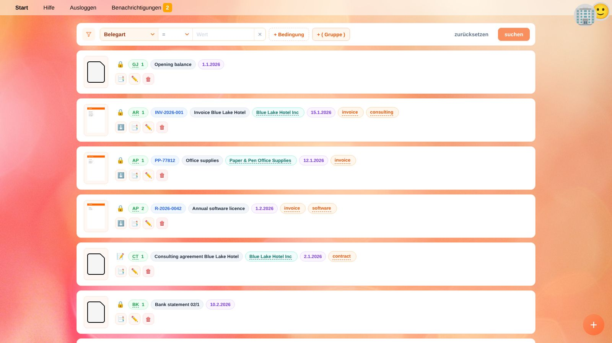

# Belege

**Dokumente** listet alle Belege des [ausgewählten Unternehmens](getting-started.de#ein-unternehmen-auswahlen): Rechnungen, Quittungen, Kontoauszüge, Verträge, Schreiben – jede Datei, die Sie aufbewahren möchten.
Ein Beleg kann auch ohne Datei existieren, z. B. für eine manuelle Umbuchung.

In YaBooks sind **Buchungen immer in einem Beleg gespeichert**. So lässt sich jede Buchung zu ihrer Quelle zurückverfolgen.

## Die Belegliste

Jede Zeile zeigt eine Vorschau der Datei und Etiketten mit den wichtigsten Informationen:

| Etikett | Bedeutung |
| --- | --- |
| 🔒 / 📝 | 🔒 der Beleg ist **gebucht**, seine Buchungen zählen in den Salden. 📝 er ist ein **Entwurf**. |
| Belegart und interne Belegnummer | z. B. `AR 1` (Ausgangsrechnung Nr. 1). Ein Klick auf die Belegart zeigt alle Belege dieser Art. |
| Externe Referenz | z. B. die Rechnungsnummer des Lieferanten. |
| Name | Der Name des Belegs bzw. seiner Datei. |
| Geschäftspartner | Ein Klick zeigt alle Belege dieses Partners. |
| Datum | Belegdatum. |
| Schlagwörter | Ein Klick zeigt alle Belege mit diesem Schlagwort. |

Beim Hinunterscrollen werden automatisch weitere Belege geladen.

### Aktionen

| Schaltfläche | Aktion |
| --- | --- |
| ⬇️ | Datei herunterladen. |
| 📑 | Buchungen des Belegs im [Hauptbuch](general-ledger.de) anzeigen. |
| ✏️ | Den [Beleg-Editor](document-editor.de) öffnen. |
| 🗑️ | Den Beleg löschen. Seine Buchungen werden ebenfalls entfernt. |

> ⚠️ **Achtung:** Gebuchte Belege mit Buchungen in einem [gesperrten Zeitraum](people.de#unternehmen) können nicht gelöscht werden.

## Belege hochladen

* Klicken Sie auf die runde **+**-Schaltfläche (*Dokumente hochladen*) rechts unten und wählen Sie eine oder mehrere Dateien aus, oder
* ziehen Sie Dateien von Ihrem Computer auf die **+**-Schaltfläche.

Jede Datei wird zu einem neuen Belegentwurf. PDFs und Bilder erhalten eine Vorschau.
Öffnen Sie den Beleg danach, um Details und Buchungen zu ergänzen, oder erfassen Sie ihn mit der [Schnellbuchungsfunktion](quick-recorder.de), indem Sie die Datei auf deren Eingabefeld ziehen.

> 💡 **Tipp:** Apps, z. B. für Scanner oder E-Mail-Import, können Belege automatisch hinzufügen.

## Suchen und Filtern

Die Filterleiste oben durchsucht alle Belege des Unternehmens.

1. Wählen Sie ein **Feld**, z. B. *Belegart*, *Name*, *Volltext* (von Apps erkannter Text, z. B. per OCR), *Schlagwörter*, *Gebucht*, *Datum*, *Interne Referenz* oder *Externe Referenz*.
2. Wählen Sie einen **Operator**: *gleich*, *ungleich*, *kleiner als*, *größer als*, … oder *enthält* (ohne Beachtung der Groß-/Kleinschreibung).
3. Geben Sie den **Wert** ein und klicken Sie auf **suchen**.

Mehrere Bedingungen kombinieren:

* **+ Bedingung** fügt eine Bedingung hinzu. Ein Klick auf **UND** / **ODER** zwischen den Bedingungen ändert die Verknüpfung.
* **+ ( Gruppe )** fügt eine Gruppe von Bedingungen in Klammern hinzu, z. B. *Belegart gleich AR* UND (*Schlagwörter enthält dringend* ODER *Datum größer als 2026-06-01*).
* **zurücksetzen** entfernt alle Filter.

Der Filter ist Teil der Seitenadresse; Neuladen oder Zurückgehen im Browser behält ihn bei.

### Nützliche Filter

| Ziel | Filter |
| --- | --- |
| Alle Entwürfe | *Gebucht* gleich *nein* |
| Alle Ausgangsrechnungen | *Belegart* gleich `AR` |
| Beleg nach Namen finden | *Name* enthält `Lizenz` |
| Belege eines Monats | *Datum* größer oder gleich `2026-03-01` UND *Datum* kleiner als `2026-04-01` |

## Belegarten

Die **Belegart** ist ein frei wählbares Kürzel. Verwenden Sie sie zusammen mit der internen Belegnummer einheitlich, um Ihre Belege zu nummerieren, zum Beispiel:

| Belegart | Verwendet für |
| --- | --- |
| `AR` | Ausgangsrechnungen |
| `ER` | Eingangsrechnungen |
| `BK` | Bankauszüge |
| `KA` | Kassabelege |
| `UB` | Umbuchungen, z. B. Eröffnungsbilanz, Abschreibungen, Abschlussbuchungen |

## Verwandte Themen

* [Beleg-Editor](document-editor.de)
* [Schnellbuchungsfunktion](quick-recorder.de)
* [Laufende Buchhaltung und Monatsabschluss](workflow-monthly.de)
