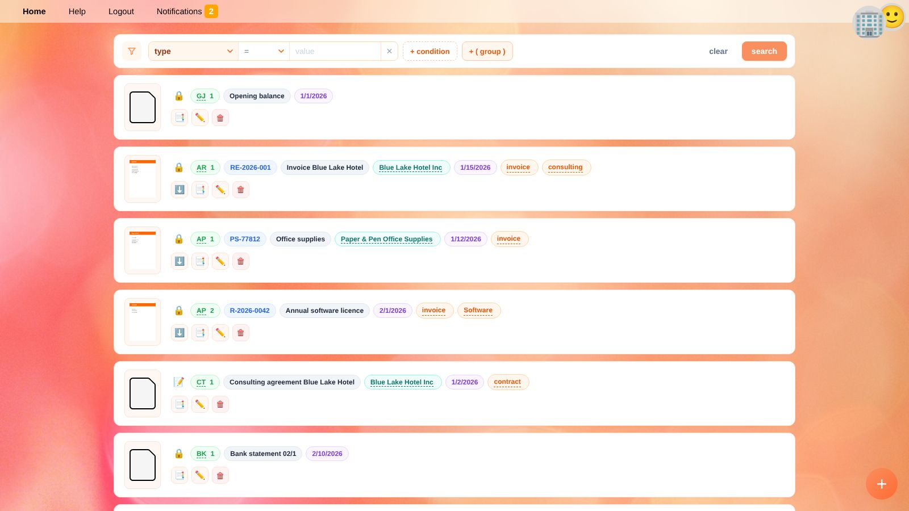

# Documents

**Documents** lists every document of the [selected business](getting-started.en#selecting-a-business): invoices, receipts, bank statements, contracts, letters – any file you want to keep.
A document can also exist without a file, e.g. for a manual journal entry.

In YaBooks, **ledger transactions are always stored within a document**. That way every booking can be traced back to its source.

## The Document List

Each row shows a thumbnail of the file and labels with the most important information:

| Label | Meaning |
| --- | --- |
| 🔒 / 📝 | 🔒 the document is **posted**, its ledger transactions count in the balances. 📝 it is a **draft**. |
| Type and internal reference | e.g. `AR 1` (outgoing invoice no. 1). Click the type to show all documents of this type. |
| External reference | e.g. the invoice number of the supplier. |
| Name | The name of the document or its file. |
| Business partner | Click it to show all documents of this partner. |
| Date | Document date. |
| Tags | Click a tag to show all documents with this tag. |

More documents are loaded automatically as you scroll down.

### Actions

| Button | Action |
| --- | --- |
| ⬇️ | Download the file. |
| 📑 | Show the ledger transactions of the document in the [general ledger](general-ledger.en). |
| ✏️ | Open the [document editor](document-editor.en). |
| 🗑️ | Delete the document. Its ledger transactions are removed as well. |

> ⚠️ **Warning:** Posted documents with ledger transactions in a [locked period](people.en#businesses) cannot be deleted.

## Uploading Documents

* Click the round **+** button (*upload documents*) in the bottom right corner and choose one or more files, or
* drag files from your computer and drop them onto the **+** button.

Every file becomes a new draft document. PDFs and images get a preview and a thumbnail.
Open the document afterwards to add its details and ledger transactions, or record it with the [quick recorder](quick-recorder.en) by dropping the file into its input field.

> 💡 **Tip:** Apps, e.g. for scanning or e-mail import, can add documents automatically.

## Searching and Filtering

The filter bar at the top searches all documents of the business.

1. Choose a **field**, e.g. *type*, *name*, *full text* (text recognized by apps, e.g. OCR), *tags*, *posted*, *date*, *internal reference* or *external reference*.
2. Choose an **operator**: *equals*, *does not equal*, *less than*, *greater than*, … or *contains* (case-insensitive).
3. Enter the **value** and click **search**.

Combine several conditions:

* **+ condition** adds a condition. Click **AND** / **OR** between conditions to switch how they are combined.
* **+ ( group )** adds a group of conditions in brackets, e.g. *type equals AR* AND (*tags contains urgent* OR *date greater than 2026-06-01*).
* **clear** removes all filters.

The filter is part of the address of the page, so reloading the page or going back in your browser keeps it.

### Useful Filters

| Goal | Filter |
| --- | --- |
| All drafts | *posted* equals *no* |
| All outgoing invoices | *type* equals `AR` |
| Find a document by its name | *name* contains `licence` |
| Documents of a month | *date* greater than or equal `2026-03-01` AND *date* less than `2026-04-01` |

## Document Types

The **type** is a short code you choose freely. Use it consistently together with the internal reference to number your documents, for example:

| Type | Used for |
| --- | --- |
| `AR` | Outgoing invoices (accounts receivable) |
| `AP` | Incoming invoices (accounts payable) |
| `BK` | Bank statements |
| `CA` | Cash receipts |
| `GJ` | General journal, e.g. opening balances, depreciation, closing entries |

## Related Topics

* [Document editor](document-editor.en)
* [Quick recorder](quick-recorder.en)
* [Day-to-day bookkeeping and monthly closing](workflow-monthly.en)
