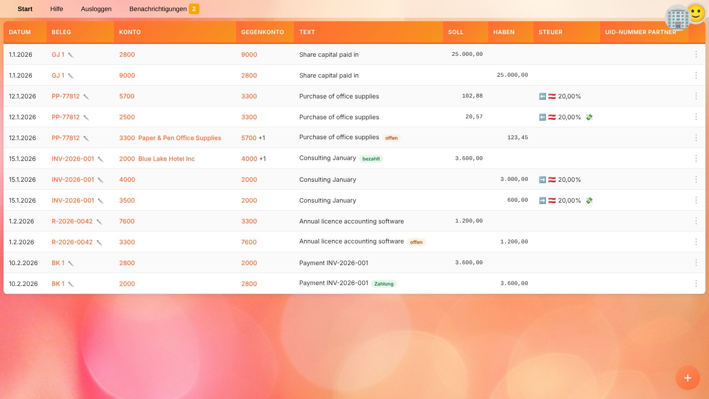
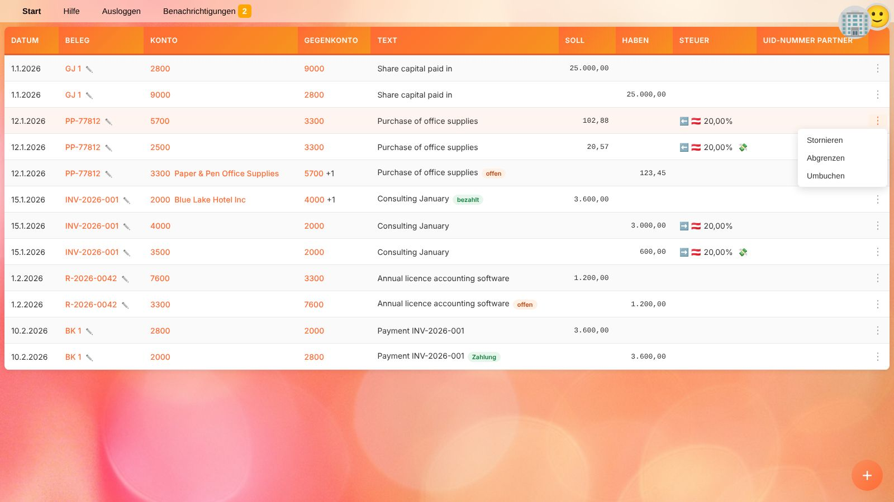
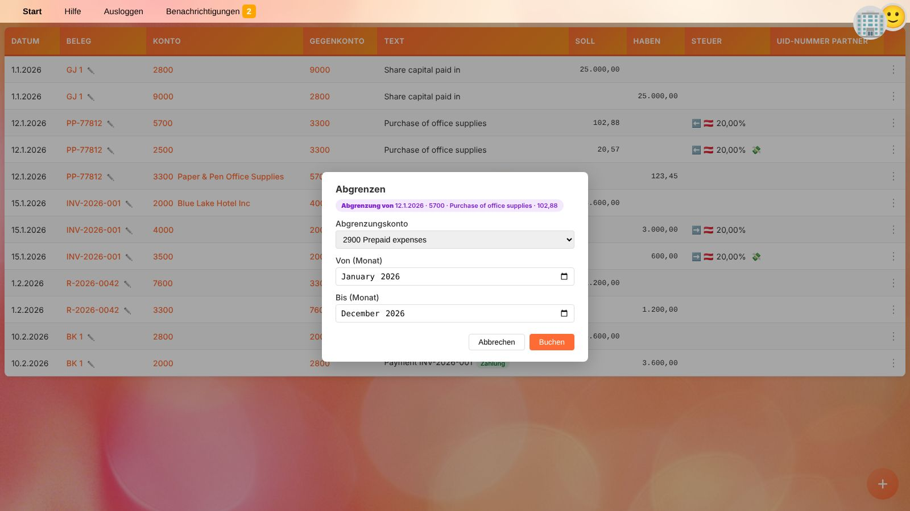

# Hauptbuch

Das Hauptbuch listet Buchungen des [ausgewählten Unternehmens](getting-started.de#ein-unternehmen-auswahlen), z. B. alle Buchungen eines Kontos oder eines Belegs.
Du öffnest es mit 📋 neben einem Konto in den [Salden](balances.de) oder mit 📑 neben einem Beleg in der [Belegliste](documents.de).

## Spalten

| Spalte | Inhalt |
| --- | --- |
| **Datum** | Buchungsdatum. |
| **Beleg** | Art und Nummer bzw. externe Referenz des Belegs. Ein Klick zeigt alle Buchungen dieses Belegs; ✏️ öffnet ihn im [Beleg-Editor](document-editor.de). |
| **Konto** | Kontonummer. Ein Klick zeigt alle Buchungen dieses Kontos. Bei Konten mit [Offene-Posten-Verwaltung](accounts.de) wird auch der Geschäftspartner angezeigt; ein Klick darauf zeigt nur dessen Buchungen auf diesem Konto. |
| **Gegenkonto** | Das Konto auf der anderen Seite der Buchung. `+1` bedeutet weitere Gegenkonten; fahre mit der Maus über die Spalte, um alle zu sehen. |
| **Text** | Buchungstext und [Etiketten](#etiketten). |
| **Soll / Haben** | Der Betrag. |
| **Steuer** | Steuercode und Steuersatz: ➡️ Umsatzsteuer, ⬅️ Vorsteuer, 🔄 Erwerbsteuer (Schuld und Vorsteuer), 💰 Steuerzahlung. 💸 kennzeichnet die Zeile mit dem Steuerbetrag selbst, die anderen sind Bemessungsgrundlage. |
| **UID-Nummer Partner** | Umsatzsteuer-Identifikationsnummer des Geschäftspartners. |
| ⋮ | [Aktionen](#aktionen) für die Buchung. |

Nur **gebuchte** Belege zählen in den Salden. Die Hauptbuchliste zeigt jedoch genau das Angeforderte, z. B. alle Buchungen eines Belegs.

## Etiketten

Farbige Etiketten neben dem Text zeigen den Zustand einer Buchung:

| Etikett | Bedeutung |
| --- | --- |
| **offen** / **teilweise offen** | Ein nicht oder nur teilweise ausgeglichener offener Posten, z. B. eine unbezahlte Rechnung. |
| **bezahlt** / **Zahlung** | Der Posten wurde bezahlt / diese Buchung ist die Zahlung einer anderen. |
| **skontiert** / **Skonto** | Auf den Posten wurde Skonto gewährt / diese Buchung ist das Skonto. |
| **storniert** / **Storno** | Die Buchung wurde rückgängig gemacht / diese Buchung ist die Stornobuchung. Beide werden durchgestrichen. |
| **umgebucht** / **Umbuchung** | Der Betrag wurde auf ein anderes Konto übertragen / diese Buchung ist die Umbuchung. Beide werden durchgestrichen. |
| **abgegrenzt** / **Abgrenzung** | Die Buchung wurde auf mehrere Monate verteilt / diese Buchung ist Teil der Verteilung. |

Ein Klick auf ein Etikett zeigt die zusammengehörigen Buchungen gemeinsam an, z. B. eine Rechnung mit all ihren Zahlungen.

## Offene Posten

Bei Konten mit **offene Posten verwalten** (siehe [Sachkonten](accounts.de#konto-anlegen-und-bearbeiten)) verfolgt YaBooks, welche Buchungen noch offen sind.
Eine Buchung wird durch andere Buchungen ausgeglichen, die als *Zahlung*, *Skonto*, *Umbuchung* oder *Storno* auf sie verweisen. Teilausgleiche sind möglich; der Rest bleibt **teilweise offen**.

Verweise entstehen

* durch [Stornieren](#stornieren) oder [Umbuchen](#umbuchen) einer Buchung im Hauptbuch,
* durch Apps, z. B. Banking-Apps, die Kontobewegungen Rechnungen zuordnen, oder über die API.

Sie werden in den [weiteren Buchungseinstellungen](document-editor.de#weitere-buchungseinstellungen) des Beleg-Editors angezeigt und können dort entfernt werden.

> 💡 **Tipp:** Um alle unbezahlten Rechnungen einer Kundin zu sehen, klicke auf den Namen des Geschäftspartners neben dem Forderungskonto und achte auf **offen**-Etiketten.

## Aktionen

Ein Klick auf ⋮ am Zeilenende öffnet das Aktionsmenü.

Alle Aktionen fügen dem **selben Beleg** neue Buchungen hinzu und buchen sie sofort. Das Buchungsdatum muss nach dem [gesperrten Zeitraum](people.de#unternehmen) des Unternehmens liegen. Nicht mögliche Aktionen sind ausgegraut.

### Stornieren

**Stornieren** macht eine Buchung rückgängig, ohne sie zu löschen:

1. Wähle **Stornieren**.
2. Gib das **Buchungsdatum der Stornobuchung** ein. Vorgeschlagen wird das ursprüngliche Buchungsdatum bzw. der erste Tag nach dem gesperrten Zeitraum, falls das ursprüngliche Datum gesperrt ist.
3. Klicke auf **Buchen**.

Alle Buchungszeilen des Belegs mit demselben Buchungsdatum (und Buch) werden storniert, sodass Soll und Haben ausgeglichen bleiben. Die ursprünglichen und die Stornobuchungen werden als **storniert** bzw. **Storno** markiert.

Storniere, statt einen Beleg zu ändern oder zu löschen, wenn die ursprüngliche Buchung bereits gemeldet wurde (z. B. in einer Umsatzsteuervoranmeldung) oder in einem gesperrten Zeitraum liegt.

### Abgrenzen

**Abgrenzen** verteilt eine Buchung linear auf mehrere Monate, z. B. eine im Voraus bezahlte Jahreslizenz:

1. Wähle **Abgrenzen**.
2. Wähle das **Abgrenzungskonto**. Angeboten werden nur Konten mit dem [Tag](accounts.de#tags) `accruals`, z. B. *Aktive Rechnungsabgrenzung*.
3. Wähle den ersten (**Von**) und letzten (**Bis**) Monat. Der Zeitraum muss mindestens zwei Monate umfassen.
4. Klicke auf **Buchen**.

YaBooks bucht den gesamten Betrag am ursprünglichen Buchungsdatum auf das Abgrenzungskonto und anschließend für jeden Monat des Zeitraums einen Anteil zurück, jeweils zum Monatsletzten.
Beispiel: 1.200,00 Lizenzgebühr von Februar bis Jänner → zwölf monatliche Aufwände von 100,00.

### Umbuchen

**Umbuchen** überträgt den Betrag einer Buchung auf ein anderes Konto, z. B. eine Kundenzahlung, die auf das falsche Forderungskonto gebucht wurde, oder eine Anzahlung, die umgegliedert wird.

1. Wähle **Umbuchen**.
2. Wähle das **Zielkonto** und das **Buchungsdatum der Umbuchung**.
3. Klicke auf **Buchen**.

Die ursprüngliche Buchung wird als **umgebucht** markiert. Auf dem Zielkonto entsteht ein neuer offener Posten mit demselben Geschäftspartner, derselben UID-Nummer und demselben Fälligkeitsdatum.

## Verwandte Themen

* [Salden](balances.de)
* [Beleg-Editor](document-editor.de)
* [Jahresabschluss vor der Veröffentlichung prüfen](workflow-financial-statements.de)
