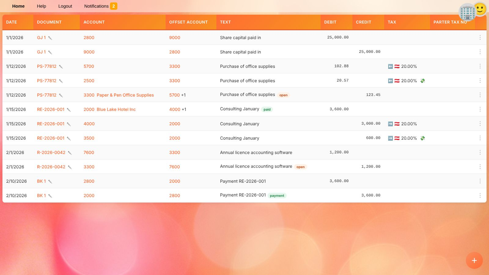
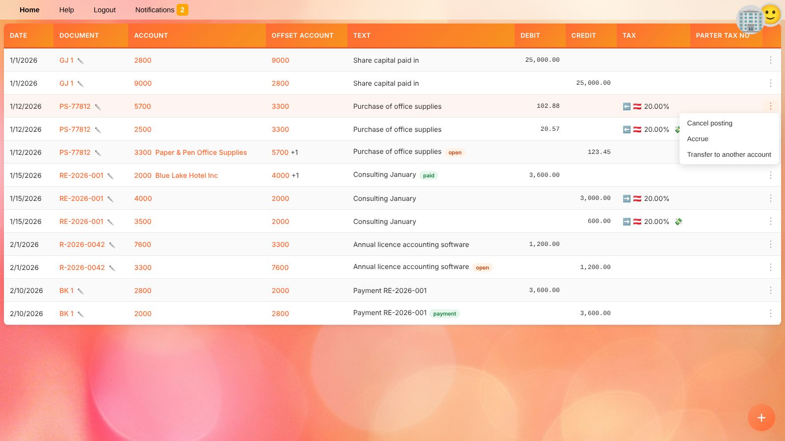
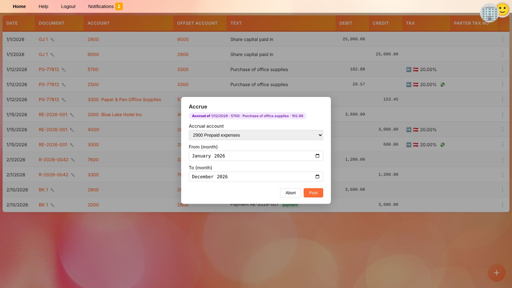

# General Ledger

The general ledger lists ledger transactions of the [selected business](getting-started.en#selecting-a-business), e.g. all transactions of an account or of a document.
Open it with 📋 next to an account in the [balances](balances.en) or with 📑 next to a document in the [document list](documents.en).

## Columns

| Column | Content |
| --- | --- |
| **Date** | Posting date. |
| **Document** | Type and number or external reference of the document. Click it to show all transactions of this document; click ✏️ to open it in the [document editor](document-editor.en). |
| **Account** | Account number. Click it to show all transactions of this account. On accounts with [open item management](accounts.en), the business partner is shown as well; click it to show only the transactions of this partner on this account. |
| **Offset Account** | The account on the other side of the booking. `+1` means there are more offset accounts; hover over the column to see all of them. |
| **Text** | Booking text and [tags](#tags). |
| **Debit / Credit** | The amount. |
| **Tax** | Tax code and rate: ➡️ output tax, ⬅️ input tax, 🔄 reverse charge (tax payable and receivable), 💰 tax payment. 💸 marks the line holding the tax amount itself, the others are the tax base. |
| **Partner Tax No** | VAT number of the business partner. |
| ⋮ | [Actions](#actions) for the transaction. |

Only **posted** documents count in the balances. The ledger list, however, shows exactly what was requested, e.g. all transactions of a document.

## Tags

Colored tags next to the text show the state of a transaction:

| Tag | Meaning |
| --- | --- |
| **open** / **partly open** | An open item that has not or only partly been settled, e.g. an unpaid invoice. |
| **paid** / **payment** | The item was paid / this transaction is the payment of another one. |
| **discounted** / **discount** | A discount was granted on the item / this transaction is the discount. |
| **canceled** / **cancelation** | The transaction was reversed / this transaction is the reversal. Both are struck through. |
| **transferred** / **transfer** | The amount was moved to another account / this transaction is the transfer. Both are struck through. |
| **accrued** / **accrual** | The transaction was distributed over several months / this transaction is part of the distribution. |

Click a tag to show the related transactions together, e.g. an invoice with all of its payments.

## Open Items

On accounts with **manage open items** (see [Ledger accounts](accounts.en#creating-and-editing-an-account)), YaBooks keeps track of which transactions are still open.
A transaction is settled by other transactions that reference it as *payment*, *discount*, *transfer* or *cancelation*. Partial settlements are possible; the remaining amount stays **partly open**.

References are created

* by [canceling](#canceling-a-posting) or [transferring](#transferring-to-another-account) a transaction in the general ledger,
* by apps, e.g. banking apps that match bank transactions with invoices, or through the API.

They are shown and can be removed in the [additional transaction settings](document-editor.en#additional-transaction-settings) of the document editor.

> 💡 **Tip:** To see all unpaid invoices of a customer, click the business partner name next to the receivables account and look for **open** tags.

## Actions

Click ⋮ at the end of a line to open the actions menu.

All actions add new ledger transactions to the **same document** and post them immediately. The posting date must be after the [locked period](people.en#businesses) of the business. Actions that are not possible for a transaction are greyed out.

### Canceling a Posting

**Cancel posting** reverses a booking without deleting it:

1. Choose **Cancel posting**.
2. Enter the **posting date of the cancelation**. It defaults to the original posting date, or to the first day after the locked period if the original date is locked.
3. Click **Post**.

All ledger transactions of the document with the same posting date (and ledger) are reversed, so debit and credit stay balanced. The original and the reversing transactions are marked **canceled** and **cancelation**.

Use cancelation instead of editing or deleting a document when the original booking has already been reported, e.g. in a VAT return, or lies in a locked period.

### Accruing

**Accrue** distributes a transaction linearly over several months, e.g. an annual software licence paid in advance:

1. Choose **Accrue**.
2. Select the **accrual account**. Only accounts [tagged](accounts.en#tags) `accruals` are offered, e.g. *Prepaid expenses*.
3. Choose the first (**From**) and last (**To**) month. The period must span at least two months.
4. Click **Post**.

YaBooks moves the whole amount to the accrual account on the original posting date and then posts one share back for each month of the period, dated the last day of the month.
Example: 1,200.00 licence fee from February to January → twelve monthly expenses of 100.00.

### Transferring to Another Account

**Transfer to another account** moves the amount of a transaction to another account, e.g. a customer payment that was booked to the wrong receivables account, or a down payment that is reclassified.

1. Choose **Transfer to another account**.
2. Select the **target account** and the **posting date of the transfer**.
3. Click **Post**.

The original transaction is marked **transferred**. On the target account a new open item is created with the same business partner, tax number and due date.

## Related Topics

* [Balances](balances.en)
* [Document editor](document-editor.en)
* [Checking the financial statements before publishing](workflow-financial-statements.en)
