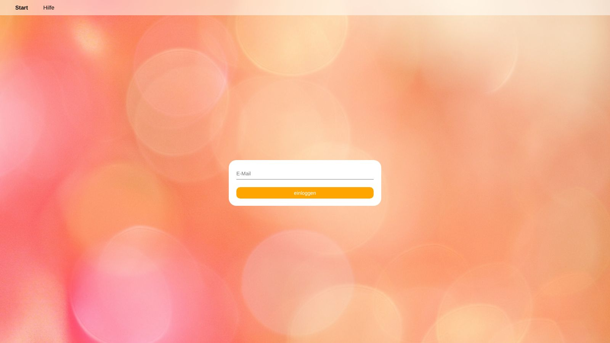
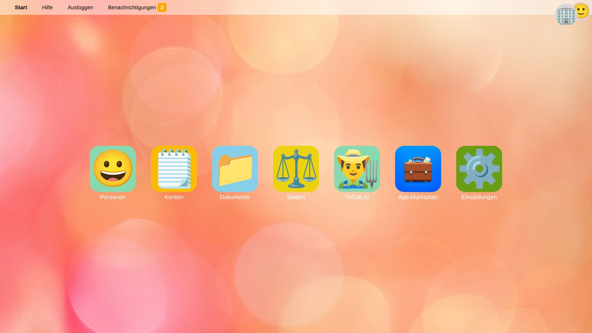
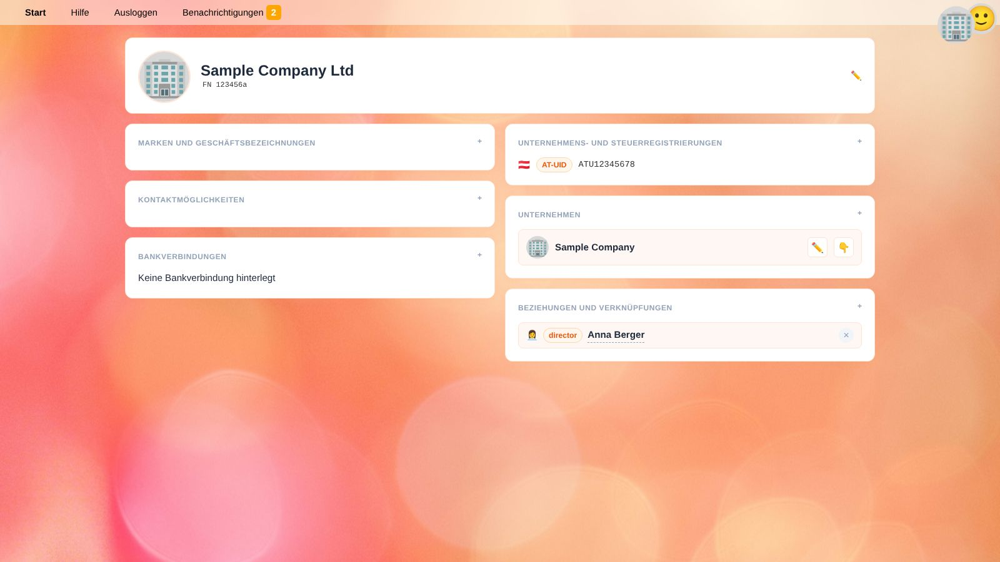
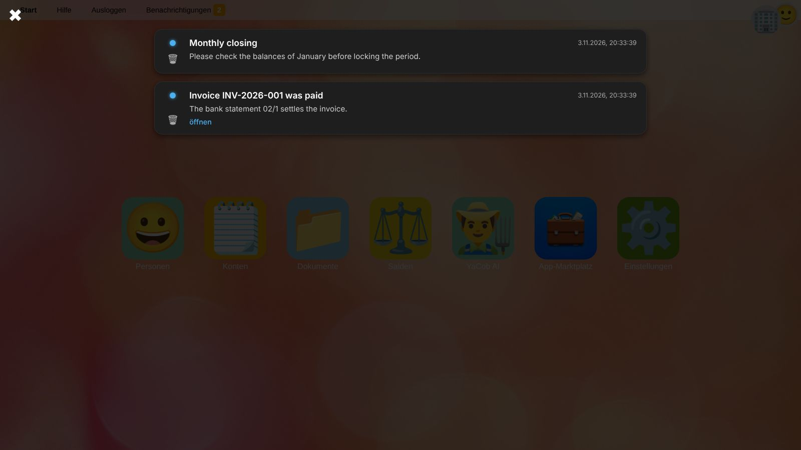
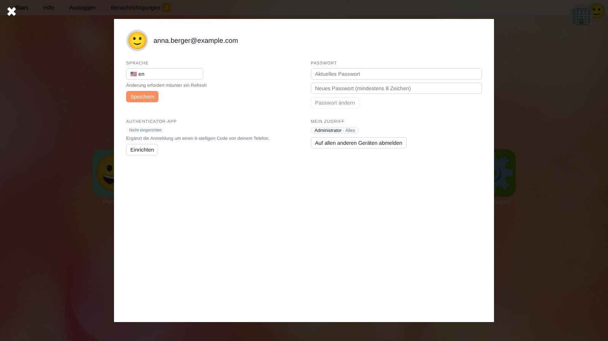

# Erste Schritte

Diese Seite erklärt, wie Sie sich anmelden, wie YaBooks aufgebaut ist und wie Sie das Unternehmen auswählen, an dem Sie arbeiten.
Falls Sie noch kein Unternehmen eingerichtet haben, lesen Sie anschließend [Ein neues Unternehmen einrichten](workflow-setup.de).

## Anmelden

1. Geben Sie Ihre **E-Mail-Adresse** ein und drücken Sie <kbd>Enter</kbd> oder klicken Sie auf **einloggen**.
2. Geben Sie Ihr **Passwort** ein.
3. Wenn Sie eine Authenticator-App eingerichtet haben (siehe [Ihr Profil](#ihr-profil)), geben Sie den **6-stelligen Code** aus der App ein.

> ⚠️ **Achtung:** Nach mehreren fehlgeschlagenen Versuchen wird die Anmeldung für Ihr Konto und Ihre Netzwerkadresse eine Zeit lang gesperrt. Warten Sie einige Minuten oder bitten Sie eine Administratorin bzw. einen Administrator, ein neues Passwort zu setzen (siehe [Einstellungen → Benutzer](settings.de#benutzer)).

In der Desktop-Version von YaBooks gibt es nur einen Benutzer, der automatisch angemeldet wird.

## Die Hauptmenüleiste

Die Leiste am oberen Fensterrand ist immer sichtbar:

| Element | Zweck |
| --- | --- |
| **Start** | Zurück zum Startbildschirm mit allen Funktionen. |
| **Hilfe** | Öffnet diese Hilfe. |
| **Ausloggen** | Meldet Sie auf diesem Gerät ab. Um sich auf allen anderen Geräten abzumelden, verwenden Sie Ihr [Profil](#ihr-profil). |
| **Benachrichtigungen** | Öffnet Ihre Benachrichtigungen. Die orange Zahl zeigt die ungelesenen an. |
| **Unternehmenslogo** (rechts oben) | Das ausgewählte Unternehmen. Fahren Sie mit der Maus darüber, um den Namen zu sehen; ein Klick öffnet **Personen**. |
| **Profilbild** (rechts oben) | Öffnet [Ihr Profil](#ihr-profil). |

Wenn sich das ausgewählte Unternehmen ändert, pulsiert sein Logo kurz und ein Ton erklingt – so arbeiten Sie nicht versehentlich am falschen Unternehmen.

## Der Startbildschirm

Jede Funktion hat eine Kachel auf dem Startbildschirm:

* [Personen](people.de) – Geschäftspartner, Ihre eigenen Gesellschaften und deren Unternehmen
* [Konten](accounts.de) – Kontenplan und Kostenstellen
* [Dokumente](documents.de) – alle Belege des ausgewählten Unternehmens
* [Salden](balances.de) – Bilanz und Gewinn- und Verlustrechnung
* Kacheln installierter [Apps](apps.de)
* [YaCob AI](yacob.de) – der KI-Assistent
* [App-Marktplatz](apps.de) – Apps installieren und verwalten
* [Einstellungen](settings.de) – nur für Benutzer sichtbar, die zumindest einen Teil der Einstellungen sehen dürfen

## Ein Unternehmen auswählen

Fast alles in YaBooks gehört zu einem Unternehmen: Konten, Kostenstellen, Belege und Salden.
Bevor Sie damit arbeiten, wählen Sie das Unternehmen aus:

1. Öffnen Sie **Personen** und klicken Sie auf die Organisation (oder Person), der das Unternehmen gehört.
2. Klicken Sie im Feld **Unternehmen** auf 👇 neben dem Unternehmen.

Das Logo des Unternehmens erscheint nun rechts oben. Die Auswahl wird in Ihrer Sitzung gespeichert und bleibt auch nach dem Neuladen der Seite erhalten.

> 💡 **Tipp:** Bleibt eine Liste leer oder erscheint die Meldung *Bitte wählen Sie zuerst einen Betrieb aus*, prüfen Sie das Logo rechts oben.

## Benachrichtigungen

Benachrichtigungen werden von YaBooks und von Apps erstellt, z. B. wenn Sie jemand [in einem Kommentar erwähnt](document-editor.de#kommentare) oder eine App eine Aufgabe abgeschlossen hat.
Neue Benachrichtigungen erscheinen auch als Systembenachrichtigung Ihres Betriebssystems, sofern Sie dies im Browser erlaubt haben.

* Klicken Sie auf den Punkt links, um eine Benachrichtigung als gelesen oder ungelesen zu markieren.
* **öffnen** führt zur zugehörigen Seite, z. B. einem Beleg.
* 🗑️ löscht eine Benachrichtigung. Aufgaben (🤹) können nicht gelöscht werden; sie werden von der App abgeschlossen, die sie erstellt hat.
* <kbd>Esc</kbd> oder ✖ schließt die Benachrichtigungszentrale.

## Ihr Profil

Klicken Sie rechts oben auf Ihr Profilbild, um Ihr Profil zu öffnen.

| Bereich | Zweck |
| --- | --- |
| **Sprache** | Die Sprache der Benutzeroberfläche. Laden Sie das Fenster nach einer Änderung neu. |
| **Passwort** | Ändern Sie Ihr Passwort. Geben Sie das aktuelle und ein neues mit mindestens 8 Zeichen ein. |
| **Authenticator-App** | Ergänzt die Anmeldung um einen 6-stelligen Code von Ihrem Telefon. Klicken Sie auf **Einrichten**, scannen Sie den QR-Code mit einer Authenticator-App (z. B. Google Authenticator, Microsoft Authenticator, 1Password) und bestätigen Sie mit dem angezeigten Code. Für ein neues Telefon entfernen Sie die Authenticator-App und richten sie erneut ein. |
| **Mein Zugriff** | Die Ihnen zugewiesenen Rollen und wo sie gelten (siehe [Rollen](settings.de#rollen)). |
| **Auf allen anderen Geräten abmelden** | Beendet alle anderen Sitzungen, z. B. wenn Sie sich an einem gemeinsam genutzten Computer nicht abgemeldet haben. |

> 💡 **Tipp:** Wenn Sie Ihr Telefon verlieren, kann eine Administratorin bzw. ein Administrator Ihre Authenticator-App unter [Einstellungen → Benutzer](settings.de#benutzer) zurücksetzen.

## Wie geht es weiter?

* [Ein neues Unternehmen einrichten](workflow-setup.de)
* [Laufende Buchhaltung und Monatsabschluss](workflow-monthly.de)
* [Übersicht aller Hilfethemen](index.de)
