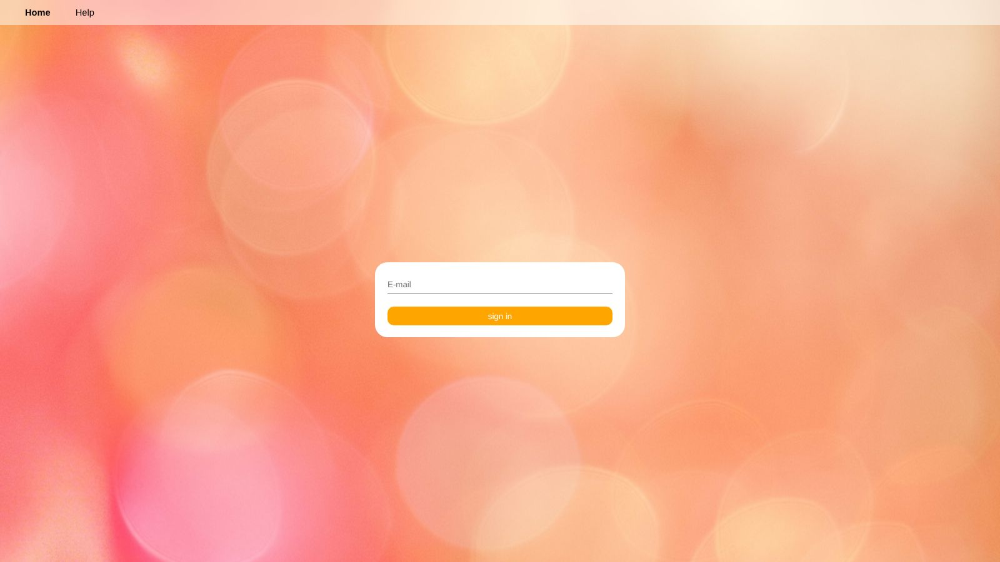
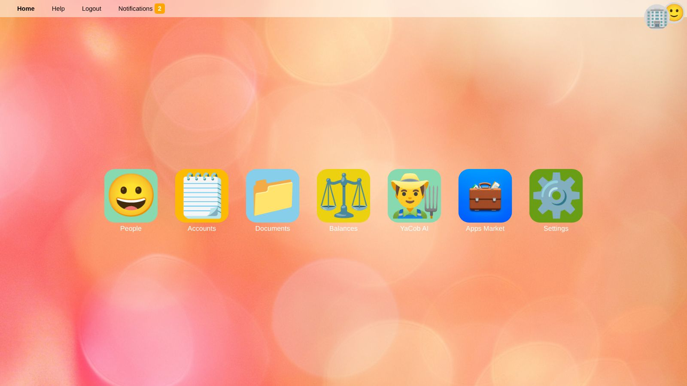
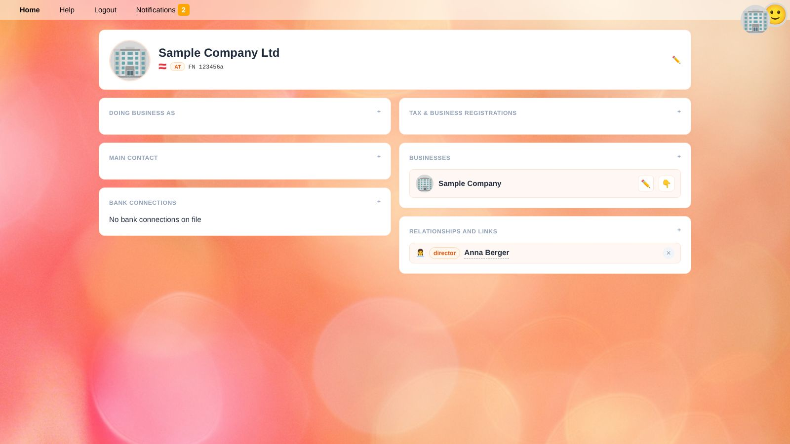
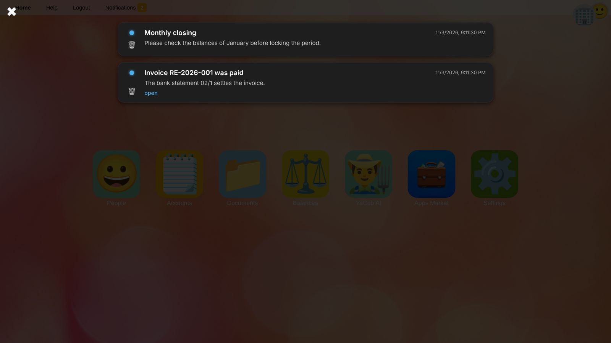
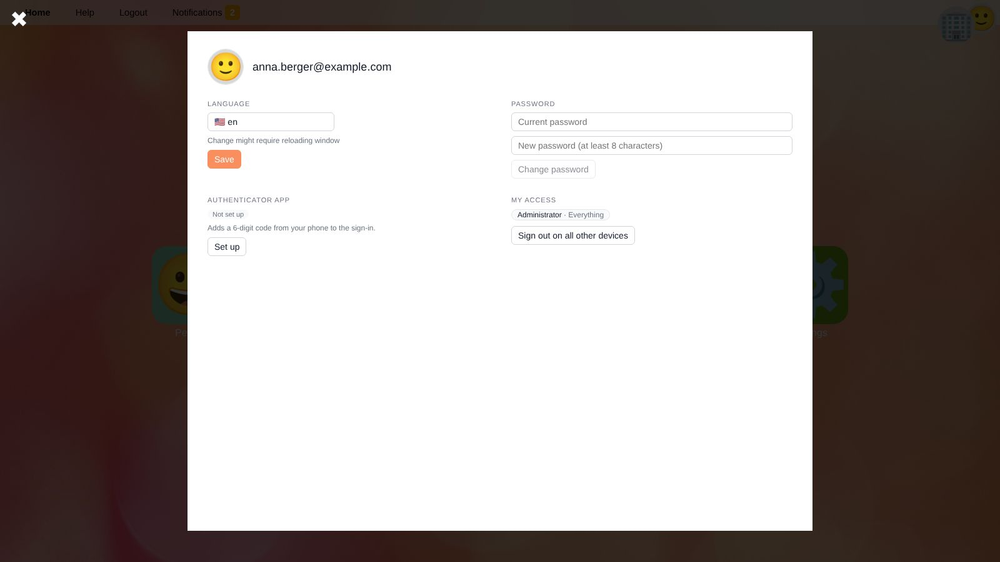

# Getting Started

This page explains how to sign in, how YaBooks is organized and how to choose the business you are working on.
If you have not set up a business yet, continue with [Setting up a new business](workflow-setup.en) afterwards.

## Signing In

1. Enter your **e-mail address** and press <kbd>Enter</kbd> or click **sign in**.
2. Enter your **password**.
3. If you have set up an authenticator app (see [Your profile](#your-profile)), enter the **6-digit code** shown in the app.

> ⚠️ **Warning:** After several failed attempts, signing in is blocked for a while for your account and network address. Wait a few minutes before you try again, or ask an administrator to set a new password for you (see [Settings → Users](settings.en#users)).

In the desktop version of YaBooks there is only one user and you are signed in automatically.

## The Main Menu Bar

The bar at the top of the window is always visible:

| Element | Purpose |
| --- | --- |
| **Home** | Returns to the home screen with all features. |
| **Help** | Opens this help. |
| **Logout** | Signs you out on this device. To sign out on all other devices, use your [profile](#your-profile). |
| **Notifications** | Opens your notifications. The orange badge counts the unread ones. |
| **Business logo** (top right) | The selected business. Hover over it to see its name; click it to open **People**. |
| **Profile picture** (top right) | Opens [your profile](#your-profile). |

When the selected business changes, its logo briefly pulses and a sound plays so that you do not accidentally work on the wrong business.

## The Home Screen

Every feature has a tile on the home screen:

* [People](people.en) – business partners, your own companies and their businesses
* [Accounts](accounts.en) – chart of accounts and cost centers
* [Documents](documents.en) – all documents of the selected business
* [Balances](balances.en) – balance sheet and income statement
* Tiles of installed [apps](apps.en)
* [YaCob AI](yacob.en) – the AI assistant
* [Apps Market](apps.en) – installing and managing apps
* [Settings](settings.en) – only shown to users who may see at least a part of the settings

## Selecting a Business

Almost everything in YaBooks belongs to a business: accounts, cost centers, documents and balances.
Before you work with them, select the business:

1. Open **People** and click the organization (or individual) that owns the business.
2. In the **Businesses** box, click the 👇 button next to the business.

The logo of the business now appears in the top right corner. The selection is stored in your session, so it stays the same when you reload the page.

> 💡 **Tip:** If a list stays empty or you see the message *Please select a business first*, check the logo in the top right corner.

## Notifications

Notifications are created by YaBooks and by apps, e.g. when someone [mentions you in a comment](document-editor.en#comments) or when an app has finished a task.
New notifications also appear as system notifications of your operating system if you allowed this in your browser.

* Click the dot on the left to mark a notification as read or unread.
* Click **open** to go to the related page, e.g. a document.
* Click 🗑️ to delete a notification. Tasks (🤹) cannot be deleted; they are completed by the app that created them.
* Press <kbd>Esc</kbd> or click ✖ to close the notification center.

## Your Profile

Click your profile picture in the top right corner to open your profile.

| Section | Purpose |
| --- | --- |
| **Language** | The language of the user interface. Reload the window after changing it. |
| **Password** | Change your password. Enter the current one and a new one with at least 8 characters. |
| **Authenticator app** | Adds a 6-digit code from your phone to the sign in. Click **Set up**, scan the QR code with an authenticator app (e.g. Google Authenticator, Microsoft Authenticator, 1Password) and confirm with the code it shows. To switch to another phone, remove the authenticator app and set it up again. |
| **My access** | The roles you have been assigned and where they apply (see [Roles](settings.en#roles)). |
| **Sign out on all other devices** | Ends all your other sessions, e.g. if you forgot to sign out on a shared computer. |

> 💡 **Tip:** If you lose your phone, an administrator can reset your authenticator app in [Settings → Users](settings.en#users).

## Where to Go Next

* [Setting up a new business](workflow-setup.en)
* [Day-to-day bookkeeping and monthly closing](workflow-monthly.en)
* [Overview of all help topics](index.en)
