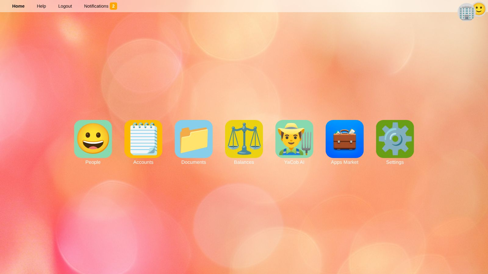

# YaBooks Help

Welcome to the YaBooks help. YaBooks is an ERP system that keeps your business partners, documents and books in one place and can be extended with apps.
These pages explain every core feature in detail and show you, step by step, how to use them for typical tasks.

> 💡 **Tip:** You can open this help at any time with **Help** in the main menu bar. Use the language switch in the top right corner of every help page to read it in another language.

## First Steps

| Topic | What you will learn |
| --- | --- |
| [Getting started](getting-started.en) | Signing in, the main menu bar, the home screen, selecting a business, notifications and your profile |
| [People, organizations and businesses](people.en) | Managing business partners and setting up the businesses you keep books for |

## Features

| Topic | What you will learn |
| --- | --- |
| [Ledger accounts and cost centers](accounts.en) | Setting up the chart of accounts, open item management, tags and cost centers |
| [Documents](documents.en) | Uploading, searching and filtering invoices, receipts and any other files |
| [Document editor](document-editor.en) | Metadata, ledger transactions, alternate ledgers, costs, links, versions and comments of a document |
| [Quick recorder](quick-recorder.en) | Recording ledger transactions with a single line of text |
| [General ledger](general-ledger.en) | Reviewing ledger transactions, open items, cancelations, accruals and transfers |
| [Balances](balances.en) | Balance sheet and income statement, unposted documents and balance reconciliations |
| [Taxes](taxes.en) | Tax codes and how taxes are recorded |
| [Settings](settings.en) | System settings, logs, jobs, users, roles and permissions |
| [Apps](apps.en) | Extending YaBooks with apps from the marketplace, packages or external services |
| [YaCob AI](yacob.en) | Asking the AI assistant questions about your data and letting it work for you |

## Workflows

The workflow pages combine the features above into step-by-step procedures for recurring tasks:

| Workflow | When to use it |
| --- | --- |
| [Setting up a new business](workflow-setup.en) | You start keeping the books of a new company |
| [Day-to-day bookkeeping and monthly closing](workflow-monthly.en) | You record incoming and outgoing invoices and payments and close a month |
| [Checking the financial statements before publishing](workflow-financial-statements.en) | You prepare the annual financial statements, review them and lock the fiscal year |

## Terms Used in This Help

| Term | Meaning |
| --- | --- |
| **Identity** | A person (individual) or an organization stored under *People*. |
| **Business** | A unit you keep books for. Every business belongs to an organization or individual. All accounts and documents belong to exactly one business. |
| **Selected business** | The business you are currently working on. It is shown as a logo in the top right corner. |
| **Document** | Any file or record, e.g. an invoice, receipt, bank statement or contract. Ledger transactions are always stored within a document. |
| **Ledger transaction** | One line of a booking: a posting date, an account and an amount. Positive amounts are debit, negative amounts are credit. |
| **Posted** | A document whose ledger transactions count in the balances. Drafts (unposted documents) do not. |
| **Locked period** | All days up to the *locked until* date of a business. Posted ledger transactions in this period can no longer be changed. |
