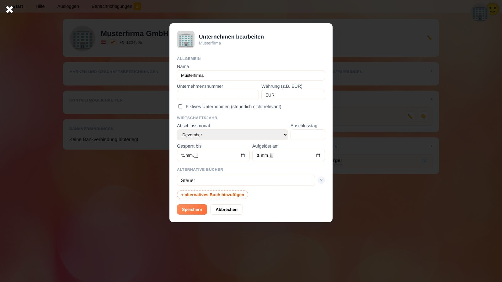

# Personen, Organisationen und Unternehmen

Unter **Personen** verwaltest du alle, die YaBooks kennen muss: Kundinnen und Kunden, Lieferanten, Mitarbeitende, Behörden – und deine eigenen Gesellschaften.
Jeder Eintrag wird als *Identität* bezeichnet und ist entweder eine **Privatperson** (natürliche Person) oder eine **Organisation** (Gesellschaft, Verein, Behörde, …).
Dieselbe Identität kann in einem Unternehmen Kunde und in einem anderen Lieferant sein; sie wird nur einmal gespeichert.

Identitäten können **Unternehmen** besitzen. Ein Unternehmen ist die Einheit, für die du Bücher führst: Es hat einen eigenen Kontenplan, eigene Belege und Salden.

## Person oder Organisation anlegen

1. Öffne **Personen** auf dem Startbildschirm.
2. Klicke auf die runde **+**-Schaltfläche rechts unten.
3. Wähle **Neue Privatperson** oder **Neue Organisation**.
4. Gib den Namen ein (Vor- und Nachname bzw. den vollständigen Namen der Organisation) und klicke auf **Speichern**.

Die neue Identität wird sofort geöffnet, sodass du die Details ergänzen kannst.

## Details einer Identität

Klicke in der Liste auf einen Namen, um die Identität zu öffnen.

Mit ✏️ in der Kopfzeile bearbeitest du Namen, Firmenbuchnummer und Rechtsordnung (zweistelliger Ländercode, z. B. `AT`); ein Klick auf Bild bzw. Logo lädt ein neues hoch.
Die Felder darunter enthalten weitere Details. Jedes Feld hat eine **+**-Schaltfläche zum Hinzufügen:

| Feld | Inhalt |
| --- | --- |
| **Marken und Geschäftsbezeichnungen** | Handelsnamen, die zusätzlich zum rechtlichen Namen verwendet werden. |
| **Kontaktmöglichkeiten** | E-Mail-Adresse, Telefonnummer (internationales Format, z. B. `+436641234567`) und Adresse. Eine Adresse muss vollständig (Straße, Nummer, PLZ und Ort) oder ganz leer sein. Mehrere Adressen sind möglich. |
| **Bankverbindungen** | IBAN, BIC, Bankname und Kontoinhaber. Wird z. B. von Banking-Apps zur Zuordnung von Zahlungen verwendet. |
| **Unternehmens- und Steuerregistrierungen** | Steuernummern und Registrierungen als Schlüssel-Wert-Paare, z. B. Schlüssel `AT-UID` und Wert `ATU12345678`. Die ersten beiden Buchstaben des Schlüssels bestimmen die angezeigte Länderflagge. |
| **Unternehmen** | Die Unternehmen dieser Identität (siehe unten). |
| **Beziehungen und Verknüpfungen** | Verbindungen zu anderen Identitäten, siehe [Beziehungen](#beziehungen). |

## Beziehungen

Beziehungen verbinden Identitäten miteinander, z. B. *Anna Berger* ist *Geschäftsführerin* der *Sample Company Ltd*.

1. Klicke im Feld **Beziehungen und Verknüpfungen** auf **+**.
2. Suche die verknüpfte Person oder Organisation.
3. Gib die **Art der Beziehung** ein, z. B. `Mitarbeiter`, `Geschäftsführer` oder `Gesellschafter`. Bereits verwendete Arten werden vorgeschlagen.
4. Wähle optional ein **Symbol** (Emoji) und einen Gültigkeitszeitraum (**Gültig ab** / **Gültig bis**).
5. Mit **Richtung tauschen** kehrst du die Beziehung bei Bedarf um; klicke dann auf **Hinzufügen**.

Beziehungen werden sofort gespeichert. Mit ✕ neben einer Beziehung entfernst du sie.

## Unternehmen

Ein Unternehmen wird bei der Identität angelegt, der es gehört.

1. Öffne die besitzende Organisation oder Person.
2. Klicke im Feld **Unternehmen** auf **+**.
3. Fülle die Einstellungen aus und klicke auf **Speichern**.

| Einstellung | Bedeutung |
| --- | --- |
| **Name** | Name des Unternehmens in YaBooks. |
| **Unternehmensnummer** | Optionale Nummer, z. B. die Klientennummer deiner Steuerberatungskanzlei. |
| **Währung** | Dreistelliger ISO-Währungscode der Bücher, z. B. `EUR`. Alle Beträge im Hauptbuch lauten auf diese Währung. |
| **Fiktives Unternehmen** | Kennzeichnet ein steuerlich nicht relevantes Unternehmen, z. B. zum Testen oder Planen. |
| **Abschlussmonat / Abschlusstag** | Letzter Tag des Wirtschaftsjahres, z. B. 31. Dezember. Die [Salden](balances.de) zeigen anhand dessen standardmäßig das laufende Wirtschaftsjahr. |
| **Gesperrt bis** | Alle Buchungsdaten bis einschließlich dieses Tages sind gesperrt: Gebuchte Buchungen dieses Zeitraums können nicht mehr hinzugefügt, geändert oder gelöscht werden. Siehe [Geschäftsjahr sperren](workflow-financial-statements.de#geschaftsjahr-sperren). |
| **Aufgelöst am** | Datum, an dem das Unternehmen aufgegeben wurde. |
| **Alternative Bücher** | Namen zusätzlicher Bücher, z. B. `Steuer` oder `IFRS`, für Abweichungen zwischen Rechnungslegungsstandards. Siehe [Alternative Bücher](document-editor.de#alternative-bucher). |

Um mit einem Unternehmen zu arbeiten, klicke auf 👇 daneben. Damit wird es zum [ausgewählten Unternehmen](getting-started.de#ein-unternehmen-auswahlen). Mit ✏️ änderst du später seine Einstellungen.

> ⚠️ **Achtung:** Das Sperren und Entsperren von Zeiträumen erfordert besondere Berechtigungen (siehe [Rollen](settings.de#rollen)). Einen bereits an das Finanzamt gemeldeten oder veröffentlichten Zeitraum zu entsperren, sollte die Ausnahme sein.

## Verwandte Themen

* [Ein neues Unternehmen einrichten](workflow-setup.de)
* [Sachkonten und Kostenstellen](accounts.de)
* [Belege](documents.de)
