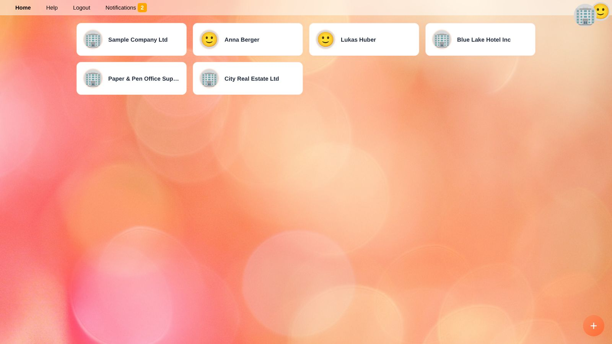
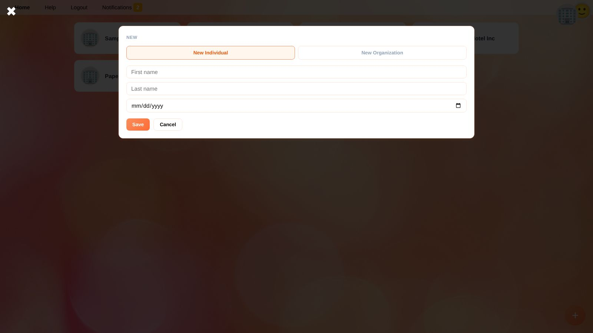
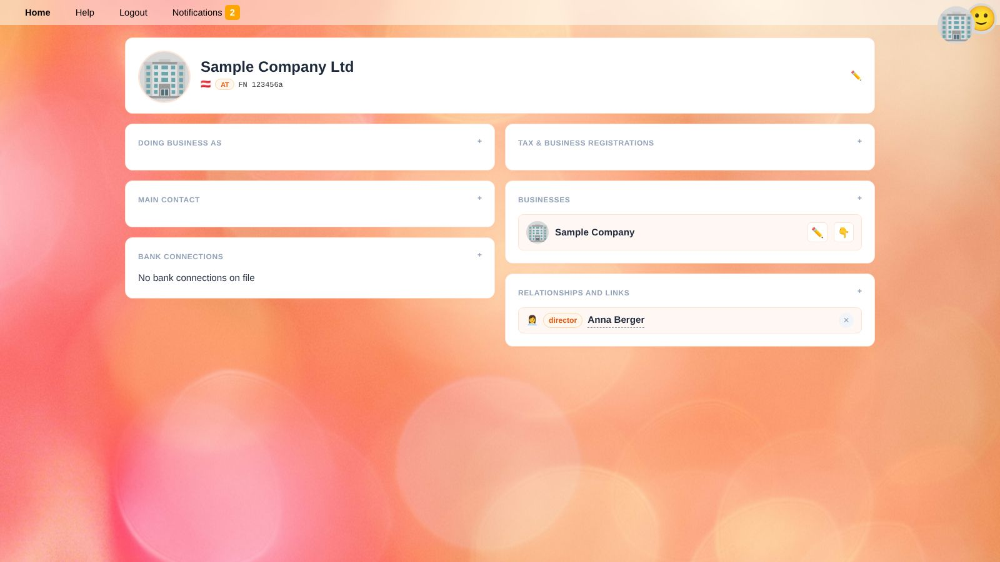
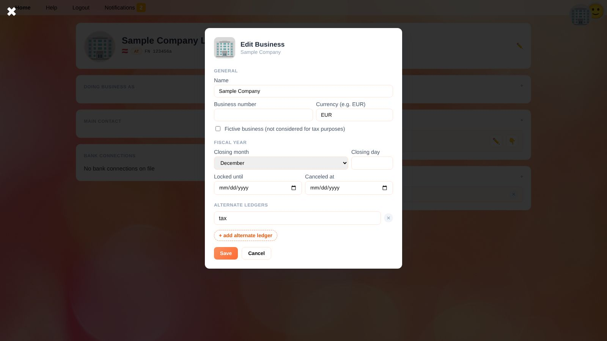

# People, Organizations and Businesses

Under **People** you manage everyone YaBooks needs to know: customers, suppliers, employees, authorities – and your own companies.
Each entry is called an *identity* and is either an **individual** (a natural person) or an **organization** (a company, association, authority, …).
The same identity can be your customer in one business and your supplier in another; it is stored only once.

Identities can own **businesses**. A business is the unit you keep books for: it has its own chart of accounts, documents and balances.

## Creating a Person or Organization

1. Open **People** from the home screen.
2. Click the round **+** button in the bottom right corner.
3. Choose **New Individual** or **New Organization**.
4. Enter the name (first and last name, or the full name of the organization) and click **Save**.

The new identity opens right away, so you can complete its details.

## Details of an Identity

Click a name in the list to open the identity.

Click ✏️ in the header to edit the name, the registration number and the jurisdiction (two-letter country code, e.g. `AT`), and click the picture or logo to upload a new one.
The boxes below the header hold further details. Each box has a **+** button to add an entry:

| Box | Content |
| --- | --- |
| **Doing business as** | Trade names the identity uses in addition to its legal name. |
| **Main contact** | E-mail address, phone number (international format, e.g. `+436641234567`) and address. An address must be complete (street, number, ZIP code and city) or left empty entirely. Several addresses can be stored. |
| **Bank connections** | IBAN, BIC, bank name and account holder. Used e.g. by banking apps to match payments. |
| **Tax & business registrations** | Tax numbers and registrations as key–value pairs, e.g. key `at.tin` and value `12 345/6789` for the Austrian tax number. The first two letters of the key show the country flag; see the recommendation below. |
| **Businesses** | The businesses owned by this identity (see below). |
| **Relationships and links** | Connections to other identities, see [Relationships](#relationships). |

> 💡 **Recommendation:** Always record tax codes and tax numbers with a country prefix, e.g. `au.abn` for the Australian Business Number. Many apps require specific codes, e.g. `at.tin` for the Austrian tax number or `at.vat.input` as the tax code for Austrian input VAT. See [Country prefixes](taxes.en#country-prefixes).

## Relationships

Relationships connect identities with one another, e.g. *Anna Berger* is *director* of *Sample Company Ltd*.

1. In the **Relationships and links** box, click **+**.
2. Search for the related person or organization.
3. Enter the **type of relationship**, e.g. `employee`, `director` or `shareholder`. Types already used elsewhere are suggested.
4. Optionally choose an **icon** (emoji) and a validity period (**valid from** / **valid until**).
5. Use **Swap direction** if the relationship points the wrong way, then click **Add**.

Relationships are saved immediately. Click ✕ next to a relationship to remove it.

## Businesses

A business is created for the identity that owns it.

1. Open the owning organization or individual.
2. In the **Businesses** box, click **+**.
3. Fill in the business settings and click **Save**.

| Setting | Meaning |
| --- | --- |
| **Name** | Name of the business as shown in YaBooks. |
| **Business number** | Optional number, e.g. a client number of your tax advisory firm. |
| **Currency** | Three-letter ISO currency code of the books, e.g. `EUR`. All amounts in the ledger are in this currency. |
| **Fictive business** | Marks a business that is not considered for tax purposes, e.g. a test or planning business. |
| **Closing month / closing day** | Last day of the fiscal year, e.g. December 31. [Balances](balances.en) start with the current fiscal year based on this. |
| **Locked until** | All posting dates up to and including this day are locked: posted ledger transactions of this period can no longer be added, changed or deleted. See [Locking a period](workflow-financial-statements.en#locking-the-fiscal-year). |
| **Canceled at** | Date the business was given up. |
| **Alternate ledgers** | Names of additional ledgers, e.g. `tax` or `ifrs`, for differences between accounting standards. See [Alternate ledgers](document-editor.en#alternate-ledgers). |

To work with a business, click 👇 next to it. This makes it the [selected business](getting-started.en#selecting-a-business). Click ✏️ to change its settings later.

> ⚠️ **Warning:** Locking and unlocking periods requires special permissions (see [Roles](settings.en#roles)). Unlocking a period that has already been reported to the tax office or published should be an exception.

## Related Topics

* [Setting up a new business](workflow-setup.en)
* [Ledger accounts and cost centers](accounts.en)
* [Documents](documents.en)
