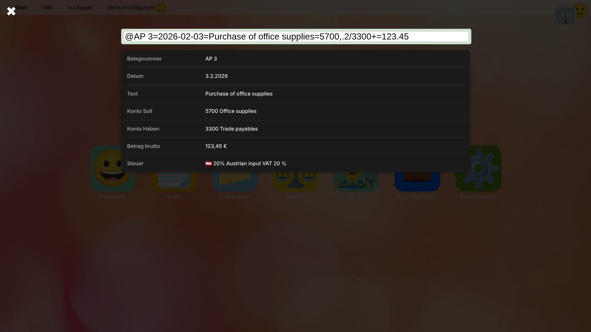

# Schnellbuchungsfunktion
Die Erfassung von Buchungszeilen erfolgt durch Eingabe eines Erfassungscodes.
Während der Eingabe erkennt das System automatisch die einzelnen Bestandteile der Buchung und bereitet einen entsprechenden Buchungssatz vor.

## Schnellbuchungsfunktion öffnen
Klicke auf die runde **+**-Schaltfläche (*Quick Recorder*) rechts unten im [Hauptbuch](general-ledger.de) oder in den [Salden](balances.de).
Gebucht wird immer für das [ausgewählte Unternehmen](getting-started.de#ein-unternehmen-auswahlen).

1. Tippe den Erfassungscode ein. Während der Eingabe werden die erkannten Bestandteile unter dem Eingabefeld aufgelistet.
   Das Feld wird **grün**, sobald die Eingabe vollständig ist, und **gelb**, solange Bestandteile fehlen oder ein Konto bzw. Steuercode nicht gefunden wird.
2. Ziehe optional eine Datei (z. B. das PDF der Rechnung) auf das Eingabefeld. Sie wird dem neuen Beleg angehängt.
3. Drücke <kbd>Enter</kbd>. Es wird ein gebuchter Beleg mit den Buchungszeilen angelegt.

Die zuletzt erfassten Belege werden unter *Kürzlich erfasste Belege* angezeigt. Ein Klick öffnet den Beleg im [Beleg-Editor](document-editor.de), z. B. um Geschäftspartner oder Fälligkeitsdatum zu ergänzen.

## Erfassungscodes
Die Eingabe muss alle erforderlichen Bestandteile einer Hauptbuchtransaktion enthalten.
Die einzelnen Bestandteile sind durch die Zeichen `+` oder `=` voneinander zu trennen.

Beispiel: `@ER 19=2026-01-12=Einkauf Bürobedarf=5700,.2/3300+=123.45`

Erforderliche Bestandteile sind:
*  Buchungsdatum
*  Buchungsbetrag
*  Hauptbuchkonten
*  Buchungssymbol und Belegnummer (optional)
*  Buchungstext (optional)

Die Reihenfolge der Bestandteile ist beliebig.

### Buchungsdatum
Das Buchungsdatum ist entweder im Format `tt.mm.jjjj`, `jjjj-mm-tt` oder `mm/tt/jjjj` zu erfassen.
Es wird als Buchungsdatum der Buchungszeilen und als Belegdatum verwendet.

### Buchungsbetrag
Als Buchungsbetrag wird jener Bestandteil interpretiert, der lediglich eine Zahl enthält. Im obigen Beispiel ist dies `123.45`.
Als Dezimaltrennzeichen sind sowohl `.`, als auch `,` erlaubt. Tausendertrennzeichen sind nicht gestattet.

### Hauptbuchkonten
Soll- und Habenkonto sind durch Angabe der Kontonummern getrennt durch einen `/` anzugeben.
Im obigen Beispiel wird somit das Konto `5700` im Soll und das Konto `3300` im Haben bebucht.
Die Konten müssen im [Kontenplan](accounts.de) des ausgewählten Unternehmens existieren; andernfalls wird ❓ statt der Kontobezeichnung angezeigt.

### Angabe von Umsatzsteuer
Ist entweder auf Soll- oder Habenseite zusätzlich ein Steuerprozentsatz angegeben, der mittels `,` und
Dezimaltrennzeichen (`,` oder `.`) vom Konto getrennt angeführt ist, wird zusätzlich eine Steuerbuchung erfasst.
Der Buchungsbetrag wird sodann als Bruttobetrag verstanden.

Der anzuwendende [Steuercode](taxes.de) wird automatisch wie folgt ermittelt:
1.  Ist am Sachkonto ein [bevorzugter Steuercode](accounts.de#bevorzugter-steuercode) hinterlegt, der mit dem angegebenen Prozentsatz kompatibel ist, so wird dieser verwendet.
2.  Anderenfalls werden die existierenden Steuercodes nach einem passenden durchsucht (Vorsteuercodes bei Aufwandskonten, Umsatzsteuercodes bei Erfolgskonten).
3.  Gibt es mehrere Codes, auf die die obigen Kriterien zutreffen, wird auf jene eingeschränkt, die mit dem Ländercode des Sitzes des Unternehmens beginnen.
4.  Trifft auch dies auf mehrere Steuercodes zu, so wird jener verwendet, der das kürzeste Kürzel führt.

Die Steuer wird auf das jeweilige Umsatz- oder Vorsteuerkonto gebucht. Dieses ist mit jenen Steuercodes zu [taggen](accounts.de#tags), für die es verwendet werden soll.
Im obigen Beispiel werden im Soll `102,88` (netto von `123.45`) auf Konto `5700` gebucht
und `20,57` auf jenes Konto, bei dem der Steuercode von 20% Vorsteuer hinterlegt ist.

### Buchungssymbol und Belegnummer
Soll ein spezifisches Buchungssymbol und eine interne Belegnummer vergeben werden, so ist dies mittels `@`-Zeichen zu signalisieren.
Danach ist das Belegsymbol und nach einem Leerzeichen die Belegnummer anzugeben.
Im obigen Beispiel wird somit das Belegsymbol `ER` und die interne Belegnummer `19` verwendet.
Sie werden zur [Belegart](documents.de#belegarten) und internen Belegnummer des neuen Belegs.

### Buchungstext
Jener Bestandteil, der nicht den Kriterien für einen der anderen Bestandteile entspricht, wird als Buchungstext interpretiert.
Im obigen Beispiel wird somit `Einkauf Bürobedarf` als Buchungstext festgelegt.

## Weitere Beispiele

| Erfassungscode | Ergebnis |
| --- | --- |
| `2026-03-01+7400/2800+1500` | Miete von 1.500,00 vom Bankkonto bezahlt, ohne Steuer. |
| `@AR 7=15.03.2026=Beratung März=2000/4000,.2=2400` | Ausgangsrechnung über 2.400,00 brutto: 2.000,00 Erlös, 400,00 Umsatzsteuer. |
| `@BK 12=31.03.2026=Bankspesen=7790/2800=12,50` | Von der Bank belastete Spesen von 12,50. |

> 💡 **Tipp:** Mit der Schnellbuchungsfunktion erfasste Zahlungen werden nicht mit den bezahlten Rechnungen verknüpft. Offene Posten werden durch Apps (z. B. Banking-Apps, die Kontobewegungen zuordnen) oder über die API ausgeglichen, siehe [Offene Posten](general-ledger.de#offene-posten).

## Verwandte Themen
* [Laufende Buchhaltung und Monatsabschluss](workflow-monthly.de)
* [Hauptbuch](general-ledger.de)
* [Steuern](taxes.de)
