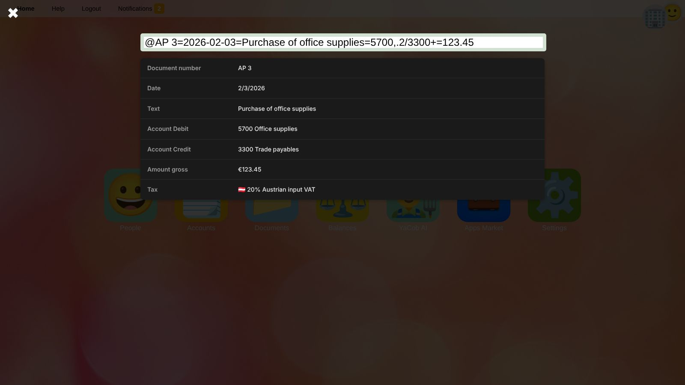

# Quick Booking Function
Booking lines are recorded by entering an input code.
During entry, the system automatically detects the individual components of the booking and prepares a corresponding journal entry.

## Opening the Quick Recorder
Click the round **+** button labeled *Quick Recorder* in the bottom right corner of the [general ledger](general-ledger.en) or the [balances](balances.en).
The quick recorder always records for the [selected business](getting-started.en#selecting-a-business).

1. Type the input code. While you type, the detected components are listed below the input field.
   The field turns **green** once the input is complete, and **yellow** while components are still missing or an account or tax code cannot be found.
2. Optionally drag a file (e.g. the PDF of the invoice) onto the input field. It is attached to the new document.
3. Press <kbd>Enter</kbd>. A posted document with the ledger transactions is created.

The documents recorded last are listed under *Recently posted documents*. Click one to open it in the [document editor](document-editor.en), e.g. to add a business partner or a due date.

## Input Codes
The input must contain all required components of a general ledger transaction.
The individual components must be separated from each other by the characters `+` or `=`.

Example: `@EXJ 19=2026-01-12=Purchase of office supplies=5700,.2/3300+=123.45`

Required components are:
*  Booking date
*  Booking amount
*  General ledger accounts
*  Booking symbol and document number (optional)
*  Booking text (optional)

The order of the components does not matter.

### Booking Date
The booking date must be entered in one of the following formats: `dd.mm.yyyy`, `yyyy-mm-dd`, or `mm/dd/yyyy`.
It is used as the posting date of the ledger transactions and as the document date.

### Booking Amount
The booking amount is interpreted as the component that contains only a number. In the example above, this is `123.45`.
Both `.` and `,` are permitted as decimal separators. Thousand separators are not permitted.

### General Ledger Accounts
Debit and credit accounts must be specified by providing the account numbers separated by a `/`.
In the example above, account `5700` is posted on the debit side and account `3300` on the credit side.
The accounts must exist in the [chart of accounts](accounts.en) of the selected business; otherwise ❓ is shown instead of the account name.

### Specification of VAT
If an additional tax percentage is specified on either the debit or credit side, separated from the account by `,` and
a decimal separator (`,` or `.`), an additional tax posting is created.
The booking amount is then understood to be a gross amount.

The applicable [tax code](taxes.en) is determined automatically as follows:
1.  If a [preferred tax code](accounts.en#preferred-tax-code) is stored on the general ledger account that is compatible with the specified percentage, this code is used.
2.  Otherwise, the existing tax codes are searched for a suitable match (input tax codes for expense accounts, output tax codes for revenue accounts).
3.  If multiple codes meet the above criteria, the selection is limited to those that begin with the lowercase country code of the company’s registered office, e.g. `at.` (see [Country prefixes](taxes.en#country-prefixes)).
4.  If this still applies to multiple tax codes, the one with the shortest code identifier is used.

The tax is posted to the respective output tax or input tax account. This account must be [tagged](accounts.en#tags) with the tax codes for which it is intended to be used.
In the example above, `102.88` (net of `123.45`) is posted to account `5700` on the debit side
and `20.57` is posted to the account on which the 20% input tax code is stored.

### Booking Symbol and Document Number
If a specific booking symbol and an internal document number are to be assigned, this must be indicated using the `@` character.
After this, the document symbol and, after a space, the document number must be specified.
In the example above, the document symbol `EXJ` and the internal document number `19` are used.
They become the [document type](documents.en#document-types) and the internal reference number of the new document.

### Booking Text
Any component that does not meet the criteria for one of the other components is interpreted as the booking text.
In the example above, `Purchase of office supplies` is therefore defined as the booking text.

## More Examples

| Input code | Result |
| --- | --- |
| `2026-03-01+7400/2800+1500` | Rent of 1,500.00 paid from the bank account, without tax. |
| `@AR 7=15.03.2026=Consulting March=2000/4000,.2=2400` | Outgoing invoice of 2,400.00 gross: 2,000.00 revenue, 400.00 output VAT. |
| `@BK 12=31.03.2026=Bank fees=7790/2800=12,50` | Bank fees of 12.50 debited by the bank. |

> 💡 **Tip:** Payments recorded with the quick recorder are not matched with the invoices they pay. Open items are settled by apps (e.g. banking apps that match bank transactions) or through the API, see [Open items](general-ledger.en#open-items).

## Related Topics
* [Day-to-day bookkeeping and monthly closing](workflow-monthly.en)
* [General ledger](general-ledger.en)
* [Taxes](taxes.en)
