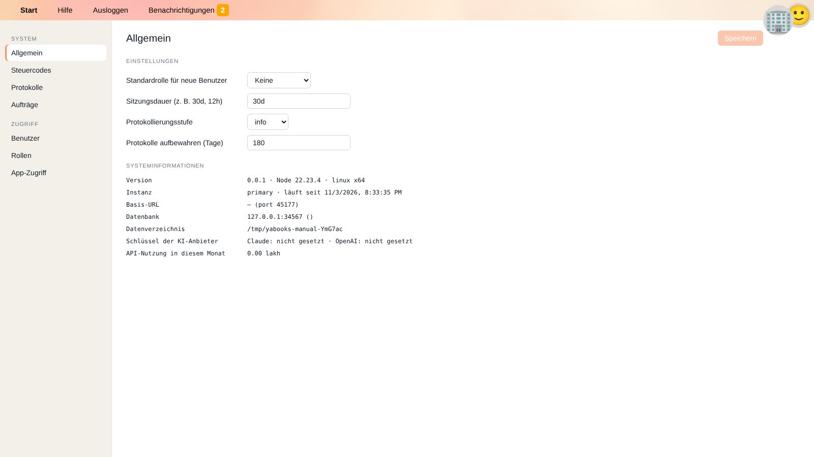
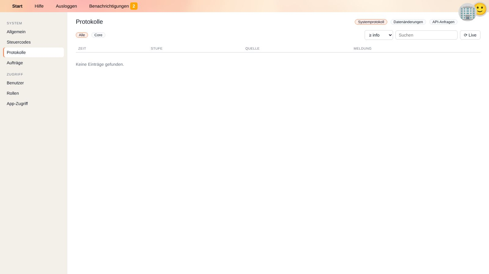
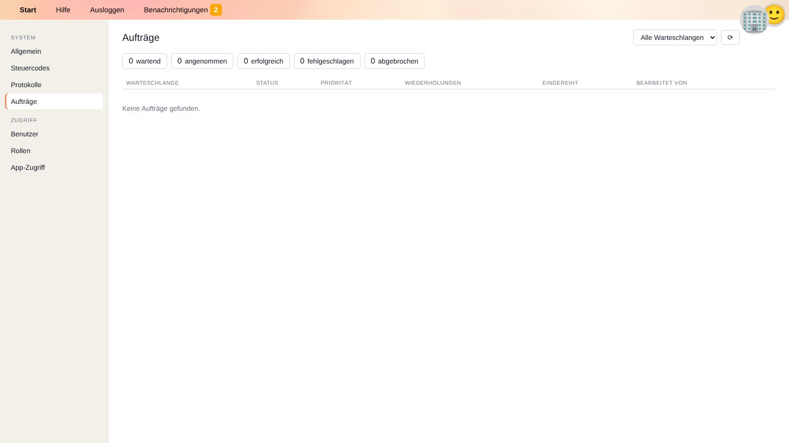
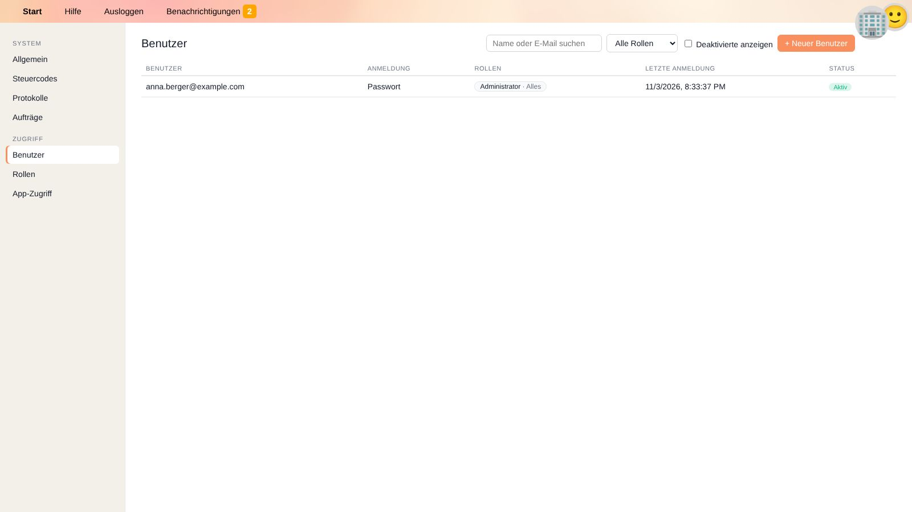
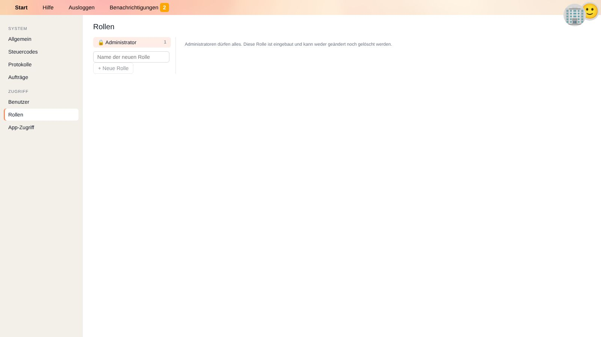
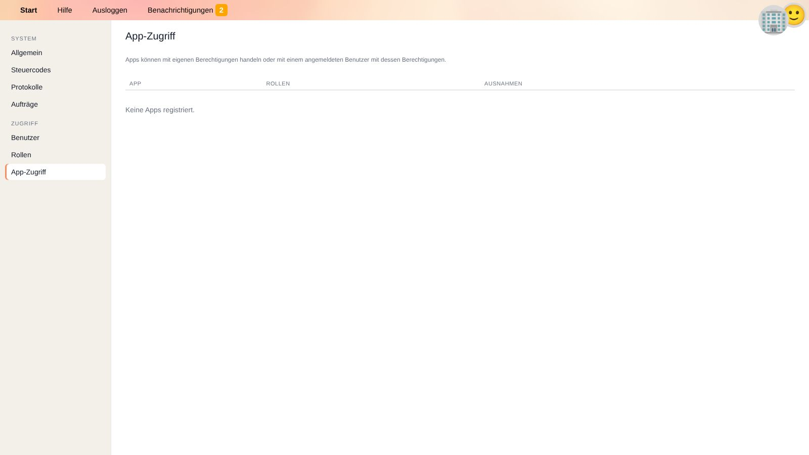

# Einstellungen

**Einstellungen** enthält die systemweite Konfiguration sowie die Verwaltung von Benutzern, Rollen und Berechtigungen.
Die Kachel am Startbildschirm und jeder Bereich werden nur Benutzern angezeigt, die sie sehen dürfen (siehe [Rollen](#rollen)).

Das Menü links ist in **System** (Allgemein, Steuercodes, Protokolle, Aufträge) und **Zugriff** (Benutzer, Rollen, App-Zugriff) gegliedert.

## Allgemein

| Einstellung | Bedeutung |
| --- | --- |
| **Standardrolle für neue Benutzer** | Die Rolle, die neue Benutzer automatisch erhalten, z. B. bei der ersten Anmeldung per Single Sign-on. *Keine* bedeutet, dass neue Benutzer nichts tun können, bis ihnen eine Rolle zugewiesen wird. |
| **Sitzungsdauer** | Wie lange Benutzer angemeldet bleiben, z. B. `30d` (30 Tage) oder `12h` (12 Stunden). |
| **Protokollierungsstufe** | Wie ausführlich das [Systemprotokoll](#protokolle) ist: von *error* (nur Fehler) bis *debug* (alles). |
| **Protokolle aufbewahren (Tage)** | Ältere Protokolleinträge werden automatisch gelöscht. |

Mit *Durch die Umgebungsvariable … festgelegt* gekennzeichnete Einstellungen werden am Server konfiguriert und können hier nicht geändert werden. Klicke nach Änderungen auf **Speichern**.

**Systeminformationen** zeigen Version, laufende Instanz, Basis-URL, Datenbank, Datenverzeichnis, ob Schlüssel der KI-Anbieter gesetzt sind (nötig für [YaCob AI](yacob.de)) und die API-Nutzung im laufenden Monat.

## Steuercodes

Hier legst du die für alle Unternehmen geltenden Steuercodes an, bearbeitest und löschst sie. Klicke auf **+ Neuer Steuercode** oder eine Zeile zum Bearbeiten; das Suchfeld findet Codes nach Code, Beschreibung oder Schlagwort.
Die Felder und ihre Bedeutung sind auf der Seite [Steuern](taxes.de#steuercodes) erklärt.

## Protokolle

Drei Ansichten helfen zu verstehen, was im System passiert ist:

| Ansicht | Inhalt | Typische Frage |
| --- | --- | --- |
| **Systemprotokoll** | Meldungen von YaBooks und Apps, filterbar nach Quelle (*Alle*, *Core*, eine App) und Mindeststufe. | Warum ist ein Import fehlgeschlagen? |
| **Datenänderungen** | Prüfprotokoll: welcher Datensatz wann von wem (Benutzer oder App) angelegt, geändert oder gelöscht wurde, mit den geänderten Werten. Filterbar nach Typ (z. B. `Document`) und Datensatz-ID. | Wer hat diese Rechnung geändert? |
| **API-Anfragen** | Anfragen an die API mit Benutzer bzw. App, Methode und Status. | Welche App ruft die API so oft auf? |

Das Suchfeld filtert die Meldungen. **Live** zeigt laufend neu eintreffende Einträge.

## Aufträge

Apps übergeben einander Arbeit über Auftragswarteschlangen, z. B. einen OCR-Auftrag für einen hochgeladenen Beleg. Die Ansicht zeigt

* Zähler für *eingereihte*, *angenommene*, *erfolgreiche*, *fehlgeschlagene* und *abgebrochene* Aufträge (ein Klick filtert danach),
* eine Liste der Aufträge mit Warteschlange, Status, Priorität, Wiederholungen, Zeitpunkt der Einreihung und bearbeitender App.

Ein Klick auf einen Auftrag zeigt seine Daten, die Apps, an die er übergeben wurde, und die gemeldeten Ergebnisse. **Wiederholen** reiht einen fehlgeschlagenen oder abgebrochenen Auftrag erneut ein, **Abbrechen** stoppt einen eingereihten Auftrag.

## Benutzer

Die Liste zeigt alle Benutzer mit Anmeldeverfahren, Rollen, letzter Anmeldung und Status. Suche, Rollenfilter und **Deaktivierte anzeigen** helfen beim Finden.

### Benutzer anlegen

1. Klicke auf **+ Neuer Benutzer**.
2. Gib **E-Mail**, ein **Anfangspasswort** und die **Sprache** ein.
3. Klicke auf **Benutzer anlegen**.
4. Weise Rollen zu, siehe [Zugriff zuweisen](#zugriff-zuweisen).

Teile das Anfangspasswort über einen sicheren Kanal mit und bitte darum, es im [Profil](getting-started.de#dein-profil) zu ändern.

### Benutzer verwalten

Ein Klick auf einen Benutzer öffnet rechts das Detailfenster:

* **Neues Passwort** – setzt ein neues Passwort und meldet den Benutzer überall ab, z. B. bei vergessenem Passwort.
* **Authenticator-App → Zurücksetzen** – entfernt die Authenticator-App, z. B. bei verlorenem Telefon. Der Benutzer wird überall abgemeldet und meldet sich danach nur mit Passwort an.
* **Benutzer deaktivieren** – der Benutzer wird überall abgemeldet und kann sich nicht mehr anmelden. Seine Daten (Kommentare, Prüfprotokoll) bleiben erhalten. **Benutzer reaktivieren** macht dies rückgängig.

### Zugriff zuweisen

Im Detailfenster eines Benutzers (oder einer App):

* **Rollen**: Wähle eine Rolle und wo sie gilt – ein **Unternehmen**, **alle Unternehmen** oder **alles** (inklusive Verwaltungsbereichen) – und klicke auf **Hinzufügen**.
* **Ausnahmen**: Erlaube oder verbiete eine einzelne Aktion in einem einzelnen Bereich, z. B. *verbieten* von *Löschen* bei *Dokumente*, ohne eine neue Rolle anzulegen.
* **Effektive Berechtigungen anzeigen** listet, was der Benutzer tatsächlich darf – aus allen Rollen und Ausnahmen kombiniert (nur gespeicherter Stand).

## Rollen

Eine Rolle legt fest, **was** getan werden darf; **wo** sie gilt, wird bei der Zuweisung an einen Benutzer oder eine App gewählt.

* **Administrator** ist eingebaut und darf alles. Diese Rolle kann weder geändert noch gelöscht werden.
* Klicke auf **+ Neue Rolle** und gib Name und Beschreibung ein.
* Die Matrix listet alle Bereiche – *Unternehmensdaten* wie Dokumente, Hauptbuch & Salden, Sachkonten, Kostenstellen, Unternehmensprofil; *gemeinsame Daten und Verwaltung* wie Personen & Organisationen, Steuercodes, Benutzer, Einstellungen, Protokolle und vollständige Sicherungen; sowie die Bereiche installierter Apps.
* Ein Klick auf eine Zelle wechselt zwischen *nicht gewährt*, *erlaubt* ✓ und *verboten* ✕. Neben **Lesen**, **Schreiben** und **Löschen** haben manche Bereiche **weitere Aktionen**, z. B. *verbuchen*, *Periode sperren* und *Periode entsperren* beim Hauptbuch oder *verwenden* bei YaCob KI.
* Eine **verbotene** Berechtigung hat Vorrang vor Berechtigungen aus anderen Rollen.

Verwaltungsbereiche wirken nur, wenn die Rolle für *alles* zugewiesen ist.

### Beispielrollen

| Rolle | Berechtigungen |
| --- | --- |
| Buchhaltung | Dokumente lesen/schreiben, Hauptbuch verbuchen, Sachkonten und Kostenstellen lesen – je Unternehmen zugewiesen. |
| Prüfung | Alles lesen, nichts schreiben – für die geprüften Unternehmen zugewiesen. |
| Leitung Rechnungswesen | Wie Buchhaltung, zusätzlich Periode sperren und Sachkonten schreiben. |

## App-Zugriff

Listet jede registrierte [App](apps.de) mit ihren Rollen und Ausnahmen. Ein Klick auf eine App ändert ihren Zugriff wie bei Benutzern.
Apps handeln entweder mit eigenen Berechtigungen oder – wenn ein angemeldeter Benutzer in einer App arbeitet – mit den Berechtigungen dieses Benutzers.

## Verwandte Themen

* [Apps](apps.de)
* [Dein Profil](getting-started.de#dein-profil)
* [Steuern](taxes.de)
