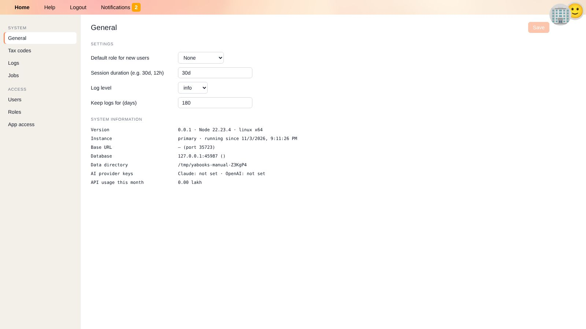
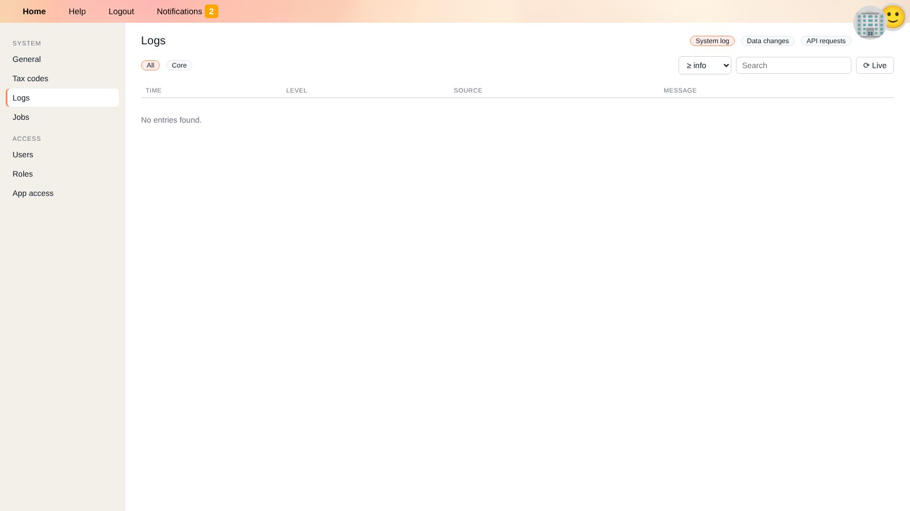
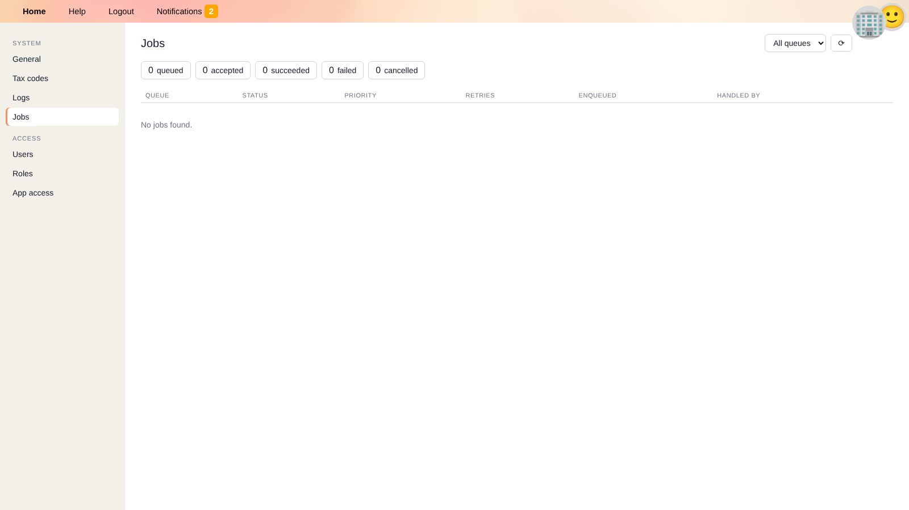
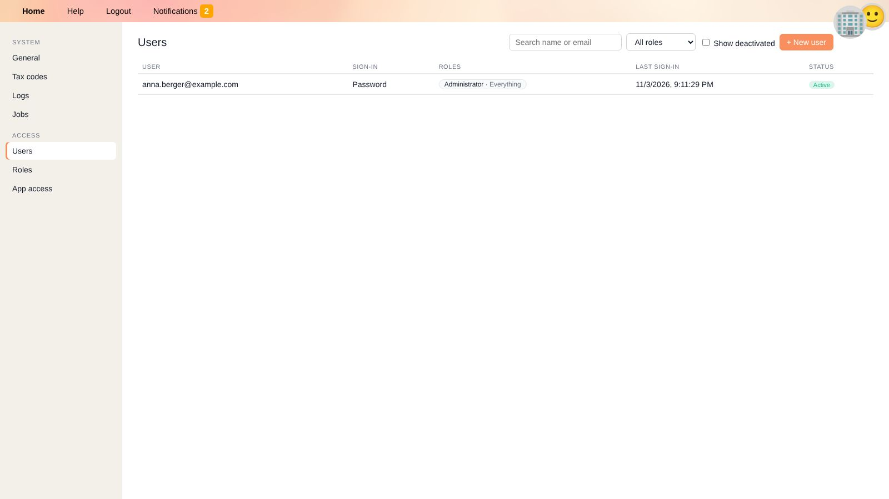
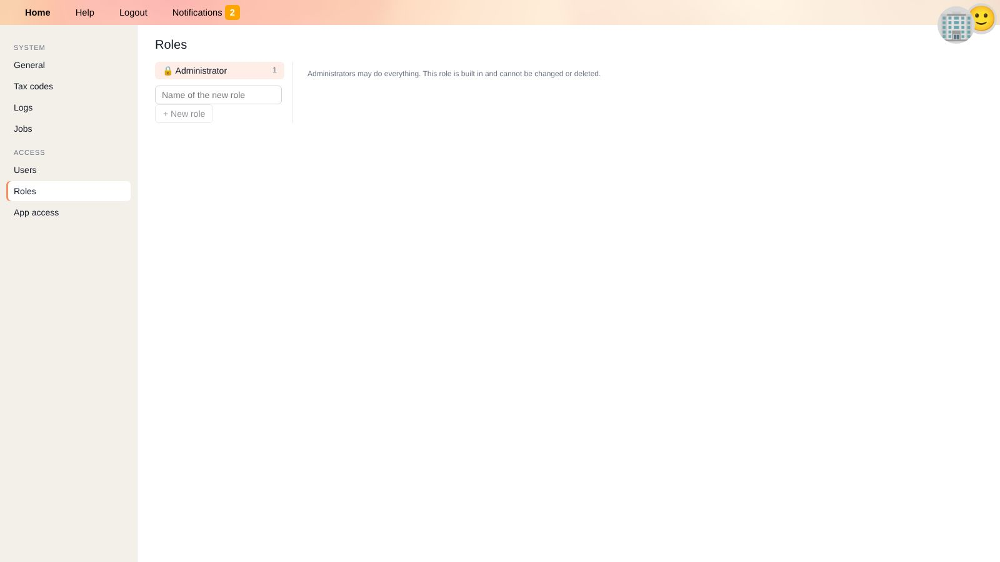
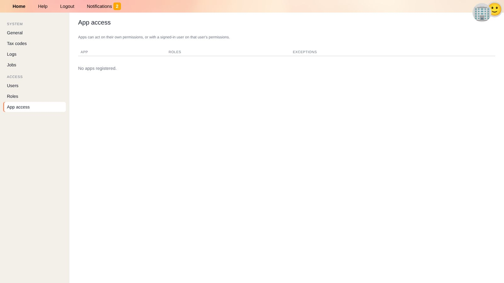

# Settings

**Settings** holds the system-wide configuration and the administration of users, roles and permissions.
The tile on the home screen and each section are only shown to users who are allowed to see them (see [Roles](#roles)).

The menu on the left is divided into **System** (General, Tax codes, Logs, Jobs) and **Access** (Users, Roles, App access).

## General

| Setting | Meaning |
| --- | --- |
| **Default role for new users** | The role new users receive automatically, e.g. when they sign in for the first time through single sign-on. *None* means new users cannot do anything until an administrator assigns them a role. |
| **Session duration** | How long users stay signed in, e.g. `30d` (30 days) or `12h` (12 hours). |
| **Log level** | How detailed the [system log](#logs) is: from *error* (only errors) to *debug* (everything). |
| **Keep logs for (days)** | Older log entries are deleted automatically. |

Settings marked *Set by the environment variable …* are configured on the server and cannot be changed here. Click **Save** after changing settings.

**System information** shows the version, the running instance, the base URL, the database, the data directory, whether AI provider keys are set (needed for [YaCob AI](yacob.en)) and the API usage of the current month.

## Tax Codes

Create, edit and delete the tax codes used by all businesses. Click **+ New tax code** or a row to edit it, and use the search field to find codes by code, description or keyword.
The fields and their meaning are explained on the [Taxes](taxes.en#tax-codes) page.

## Logs

Three views help you understand what happened in the system:

| View | Content | Typical question |
| --- | --- | --- |
| **System log** | Messages of YaBooks and of apps, filterable by source (*All*, *Core*, an app) and minimum level. | Why did an import fail? |
| **Data changes** | Audit log: which record was created, changed or deleted, when and by whom (user or app), with the changed values. Filter by type (e.g. `Document`) and record ID. | Who changed this invoice? |
| **API requests** | Requests to the API with user or app, method and status. | Which app is calling the API so often? |

Use the search field to filter messages. **Live** continuously shows new entries as they arrive.

## Jobs

Apps hand over work to each other through job queues, e.g. an OCR job for an uploaded document. The jobs view shows

* counters of *queued*, *accepted*, *succeeded*, *failed* and *cancelled* jobs (click one to filter),
* a list of jobs with queue, status, priority, retries, the time they were enqueued and the app handling them.

Click a job to see its payload, the apps it was handed over to and the reported outcomes. **Retry** puts a failed or cancelled job back into the queue, **Cancel** stops a queued job.

## Users

The list shows all users with their sign-in method, roles, last sign-in and status. Use the search, the role filter and **Show deactivated** to find users.

### Creating a User

1. Click **+ New user**.
2. Enter the **e-mail address**, an **initial password** and the **language**.
3. Click **Create user**.
4. Assign roles, see [Assigning access](#assigning-access).

Tell the user the initial password through a secure channel and ask them to change it in their [profile](getting-started.en#your-profile).

### Managing a User

Click a user to open the details panel on the right:

* **New password** – sets a new password and signs the user out everywhere, e.g. if they forgot their password.
* **Authenticator app → Reset** – removes the authenticator app, e.g. if the user lost their phone. The user is signed out everywhere and then signs in with their password only.
* **Deactivate user** – the user is signed out everywhere and can no longer sign in. Their data (comments, audit log) is kept. **Reactivate user** reverses this.

### Assigning Access

In the details panel of a user (or an app):

* **Roles**: choose a role and where it applies – one **business**, **all businesses** or **everything** (including administration areas) – and click **Add**.
* **Exceptions**: allow or deny a single action in a single area, e.g. *deny* *delete* on *Documents*, without creating a new role.
* **Show effective permissions** lists what the user can actually do, combining all roles and exceptions (saved state only).

## Roles

A role defines **what** may be done; **where** it applies is chosen when the role is assigned to a user or an app.

* **Administrator** is built in and may do everything. It cannot be changed or deleted.
* Click **+ New role**, enter a name and a description.
* The matrix lists all areas – *business data* such as documents, general ledger & balances, ledger accounts, cost centers, business profile; *shared data and administration* such as people & organizations, tax codes, users, settings, logs and full backups; and the areas of installed apps.
* Click a cell to switch between *not granted*, *allowed* ✓ and *denied* ✕. Besides **Read**, **Write** and **Delete**, some areas have **other actions**, e.g. *record* (post ledger transactions), *lock period* and *unlock period* for the general ledger, or *use* for YaCob AI.
* A **denied** permission overrides permissions granted by other roles.

Administration areas only take effect when a role is assigned for *everything*.

### Example Roles

| Role | Permissions |
| --- | --- |
| Bookkeeper | Read/write documents, record general ledger, read accounts and cost centers – assigned per business. |
| Auditor | Read everything, write nothing – assigned for the businesses under audit. |
| Accounting lead | Like bookkeeper, plus lock period and write ledger accounts. |

## App Access

Lists every registered [app](apps.en) with its roles and exceptions. Click an app to change its access in the same way as for users.
Apps either act on their own permissions or, when a signed-in user works within an app, on that user's permissions.

## Related Topics

* [Apps](apps.en)
* [Your profile](getting-started.en#your-profile)
* [Taxes](taxes.en)
