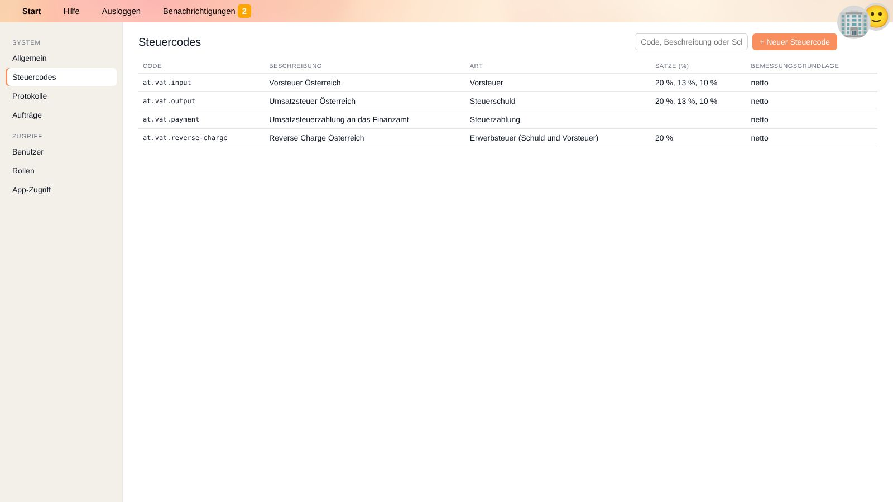

# Steuern

YaBooks erfasst Steuern wie die Umsatzsteuer direkt an den Buchungen. Jede für eine Steuererklärung relevante Buchung trägt einen **Steuercode** und einen **Steuersatz**.
Daraus lassen sich Steuererklärungen für beliebige Zeiträume erstellen – durch Apps oder über die API.

## Steuercodes

Steuercodes gelten für alle Unternehmen und werden unter **Einstellungen → Steuercodes** verwaltet (siehe [Einstellungen](settings.de#steuercodes)).

| Feld | Bedeutung |
| --- | --- |
| **Code** | Eindeutige Kennung, beginnend mit dem kleingeschriebenen zweistelligen Ländercode, z. B. `at.vat.input`. Die [Schnellbuchungsfunktion](quick-recorder.de#angabe-von-umsatzsteuer) bevorzugt Codes des Sitzlandes, und im Hauptbuch wird die Länderflagge angezeigt. |
| **Beschreibung** | z. B. *Vorsteuer Österreich*. |
| **Art** | Siehe unten. |
| **Sätze (%)** | Die Steuersätze, mit denen der Code verwendet werden kann, durch Beistriche getrennt, z. B. `20, 13, 10`. |
| **Bemessungsgrundlage** | Ob der Satz auf den **Netto**betrag (üblich bei der Umsatzsteuer) oder den **Brutto**betrag angewandt wird. |
| **Währung** | Währung der Steuerbehörde. |
| **Schlagwörter** | Zusätzliche Suchbegriffe. |
| **Untercodes** | Feinere Gliederung eines Steuercodes, z. B. die einzelnen Kennzahlen eines Steuerformulars mit demselben Steuersatz. |

Von einer App bereitgestellte Steuercodes sind als solche gekennzeichnet; Änderungen können von der App überschrieben werden.
Ein gelöschter Steuercode bleibt in bestehenden Belegen erhalten, kann aber nicht mehr ausgewählt werden.

### Arten von Steuercodes

| Art | Verwendet für | Im Hauptbuch dargestellt als |
| --- | --- | --- |
| **Steuerschuld** | Umsatzsteuer auf Verkäufe, die Kunden verrechnet wird. | ➡️ |
| **Vorsteuer** | Abziehbare Vorsteuer auf Einkäufe. | ⬅️ |
| **Erwerbsteuer (Schuld und Vorsteuer)** | Steuern, die der Käufer gleichzeitig schuldet und abzieht, z. B. Reverse Charge oder innergemeinschaftlicher Erwerb. | 🔄 |
| **Steuerzahlung** | Zahlungen an bzw. Erstattungen vom Finanzamt. | 💰 |

## Länderpräfixe

> 💡 **Empfehlung:** Erfasse Steuercodes und Steuernummern immer mit Länderpräfix, z. B. `au.abn` für die australische Business Number. Viele Apps setzen die Verwendung bestimmter Codes voraus, z. B. `at.tin` für die österreichische Steuernummer oder `at.vat.input` als Steuercode für die österreichische Vorsteuer.

Das Präfix ist der kleingeschriebene zweistellige Ländercode, gefolgt von einem Punkt. Verwende die Codes, die deine Apps erwarten; legst du Steuercodes selbst an, folge demselben Schema:

| Code | Verwendet für |
| --- | --- |
| `at.vat.output` | Steuercode: österreichische Umsatzsteuer |
| `at.vat.input` | Steuercode: österreichische Vorsteuer |
| `at.tin` | Steuernummer: österreichische Steuernummer |
| `au.abn` | Steuernummer: australische Business Number |

Das Präfix hat praktische Auswirkungen:

* Die [Schnellbuchungsfunktion](quick-recorder.de#angabe-von-umsatzsteuer) bevorzugt Steuercodes des Sitzlandes des Unternehmens, aber nur, wenn sie mit dessen **kleingeschriebenem** Ländercode beginnen (`at.…`, nicht `AT-…`).
* Das Hauptbuch und die Steuerregistrierungen von [Personen und Organisationen](people.de#details-einer-identitat) zeigen die aus den ersten beiden Buchstaben abgeleitete Länderflagge.
* Codes verschiedener Länder kommen einander nie in die Quere, z. B. `at.vat.input` und `de.vat.input`.

## Steuern erfassen

Eine steuerpflichtige Buchung besteht aus mindestens zwei Zeilen mit demselben Steuercode und Steuersatz:

* der Zeile mit der **Bemessungsgrundlage** (z. B. Erlös oder Aufwand, Nettobetrag) – das Kästchen *Bemessungsgrundlage* ist angehakt, und
* der Zeile mit dem **Steuerbetrag** auf dem Steuerkonto – das Kästchen ist nicht angehakt (💸 im Hauptbuch).

Beispiel: Eingangsrechnung über 123,45 inklusive 20 % USt

| Konto | Betrag | Steuercode | Bemessungsgrundlage |
| --- | ---: | --- | --- |
| 5700 Büromaterial | 102,88 | at.vat.input 20 % | ☑ |
| 2500 Vorsteuer | 20,57 | at.vat.input 20 % | ☐ |
| 3300 Verbindlichkeiten | −123,45 | | |

Es gibt zwei Wege, dies zu erfassen:

* In der [Schnellbuchungsfunktion](quick-recorder.de#angabe-von-umsatzsteuer): `2026-01-12=Büromaterial=5700,.2/3300=123,45` – Steuercode und Steuerzeile werden automatisch ergänzt.
* Im [Beleg-Editor](document-editor.de#hauptbuch): Steuercode in jeder Zeile wählen und das Kästchen *Bemessungsgrundlage* setzen.

Bei Reverse Charge erfasst du sowohl eine Umsatzsteuer- als auch eine Vorsteuerzeile mit demselben Code.

## Steuerkonten einrichten

1. Lege die benötigten Steuercodes an (oder installiere eine App, die die Steuercodes deines Landes bereitstellt).
2. Lege ein Fremdkapitalkonto für die Umsatzsteuer an (z. B. *3500 Umsatzsteuer*) und tagge es mit allen Umsatzsteuercodes, z. B. `at.vat.output`.
3. Lege ein Vermögenskonto für die Vorsteuer an (z. B. *2500 Vorsteuer*) und tagge es mit allen Vorsteuercodes, z. B. `at.vat.input`.
4. Setze optional einen [bevorzugten Steuercode](accounts.de#bevorzugter-steuercode) bei Erlös- und Aufwandskonten.

Wie Konten getaggt werden, steht unter [Tags](accounts.de#tags).

## Steuern prüfen

* Filtere im [Hauptbuch](general-ledger.de) die Steuerkonten und prüfe, dass jede Zeile einen Steuercode trägt.
* Stimme die Steuerkonten in den [Salden](balances.de#kontoabstimmung) mit deiner Umsatzsteuervoranmeldung ab.
* Erfasse bei innergemeinschaftlichen Lieferungen die UID-Nummer des Partners in den [weiteren Buchungseinstellungen](document-editor.de#weitere-buchungseinstellungen); sie wird für die Zusammenfassende Meldung benötigt.

## Verwandte Themen

* [Sachkonten](accounts.de)
* [Schnellbuchungsfunktion](quick-recorder.de)
* [Laufende Buchhaltung und Monatsabschluss](workflow-monthly.de)
