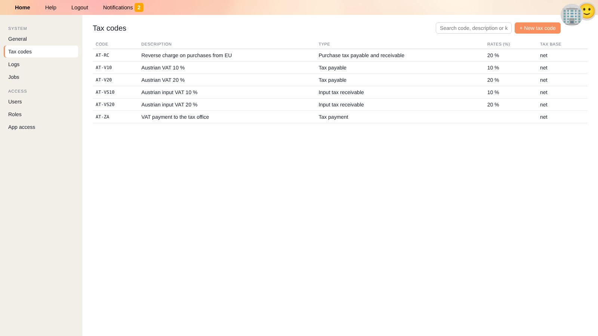

# Taxes

YaBooks records taxes such as VAT directly on the ledger transactions. Every transaction that is relevant for a tax return carries a **tax code** and a **tax rate**.
From this information, tax returns can be prepared for any period – by apps or through the API.

## Tax Codes

Tax codes are shared by all businesses and managed under **Settings → Tax codes** (see [Settings](settings.en#tax-codes)).

| Field | Meaning |
| --- | --- |
| **Code** | Unique identifier. Start it with the two-letter country code, e.g. `AT-V20`; the [quick recorder](quick-recorder.en#specification-of-vat) prefers codes of the business's home country and the country's flag is shown in the ledger. |
| **Description** | e.g. *Austrian VAT 20 %*. |
| **Type** | See below. |
| **Rates (%)** | The rates this code can be used with, separated by commas, e.g. `20, 10`. |
| **Tax base** | Whether the rate applies to the **net** amount (usual for VAT) or the **gross** amount. |
| **Currency** | Currency of the tax authority. |
| **Keywords** | Additional search words. |
| **Sub codes** | Further breakdown of a tax code, e.g. the individual boxes of a tax return form that share the same rate. |

Tax codes provided by an app are marked as such; changes may be overwritten by the app.
A deleted tax code remains on existing documents but can no longer be selected.

### Types of Tax Codes

| Type | Used for | Shown in the ledger as |
| --- | --- | --- |
| **Tax payable** | Output tax on sales, e.g. VAT charged to customers. | ➡️ |
| **Input tax receivable** | Input tax on purchases that can be reclaimed. | ⬅️ |
| **Purchase tax payable and receivable** | Taxes the buyer owes and reclaims at the same time, e.g. reverse charge or intra-community acquisitions. | 🔄 |
| **Tax payment** | Payments to or refunds from the tax office. | 💰 |

## Recording Taxes

A taxable booking consists of at least two lines with the same tax code and rate:

* the **tax base** line (e.g. the revenue or expense, net amount) – the *tax base* box is checked, and
* the **tax amount** line on the tax account – the *tax base* box is unchecked (💸 in the ledger).

Example: incoming invoice of 123.45 including 20 % VAT

| Account | Amount | Tax code | Tax base |
| --- | ---: | --- | --- |
| 5700 Office supplies | 102.88 | AT-VS20 20 % | ☑ |
| 2500 Input VAT | 20.57 | AT-VS20 20 % | ☐ |
| 3300 Trade payables | −123.45 | | |

There are two ways to record this:

* In the [quick recorder](quick-recorder.en#specification-of-vat): `2026-01-12=Office supplies=5700,.2/3300=123.45` – the tax code and tax line are added automatically.
* In the [document editor](document-editor.en#ledger): choose the tax code on each line and set the *tax base* box.

For reverse charge, add both an output and an input tax line with the same code.

## Setting Up Tax Accounts

1. Create the tax codes you need (or install an app that provides the tax codes of your country).
2. Create a liability account for output tax (e.g. *3500 VAT payable*) and tag it with all output tax codes, e.g. `AT-V20`, `AT-V10`.
3. Create an asset account for input tax (e.g. *2500 Input VAT*) and tag it with all input tax codes, e.g. `AT-VS20`.
4. Optionally set a [preferred tax code](accounts.en#preferred-tax-code) on revenue and expense accounts.

See [Tags](accounts.en#tags) for how to tag accounts.

## Checking Taxes

* In the [general ledger](general-ledger.en), filter the tax accounts and check that every line carries a tax code.
* Reconcile the tax accounts with your tax return in the [balances](balances.en#balance-reconciliation).
* Use the business partner tax number in the [additional transaction settings](document-editor.en#additional-transaction-settings) for EU sales to other businesses; it is needed for recapitulative statements.

## Related Topics

* [Ledger accounts](accounts.en)
* [Quick recorder](quick-recorder.en)
* [Day-to-day bookkeeping and monthly closing](workflow-monthly.en)
